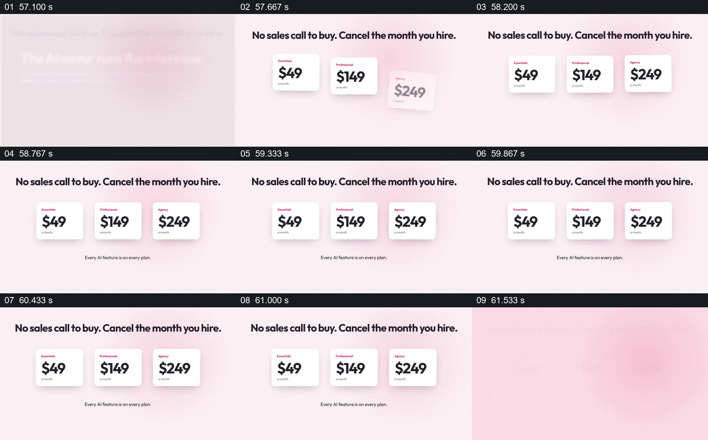

# 把三个方案并排放在同一价格说明下

- 作品：案例 010《手机录音与人物视频窗口》（索引名称）。
- 原片范围：00:57.000–01:02.000，含起点、不含终点；[完整原片](../video.mp4)｜[本卡片段](c06.mp4)。
- 观察方式：依据整片 64 宫格和约每秒一次的真实源帧观察，未连续原速观看；媒体探测显示原片没有音轨，因此没有可听审的原声。

## 原画面具体怎样设计

浅色画面顶部写“No sales call to buy. Cancel the month you hire.”，中间横排三张白色卡片，分别显示 49、149、249 美元；下方一行说明各方案包含 AI 功能。画面保持整组比较。

## 为什么这样设计，好在哪里

统一卡片大小与并排位置让不同价格处于相同比较层级，顶部一句和下方共同条件把价格放回购买语境。原片数字只是演示，当前价格、周期及适用条款均未核验。

以上为依据画面的分析，非作者自述；预期观看效果未经观众测试。

## 可直接使用的创意指令

当要比较有限的产品方案时，使用同一时间、币种和周期的已核实价格，把方案并列并标出关键差异与共同条件；需要说明取消或附加费用时放在相邻可读位置。保持足够长的静态阅读时间，并给出可追溯的最新条款入口。
