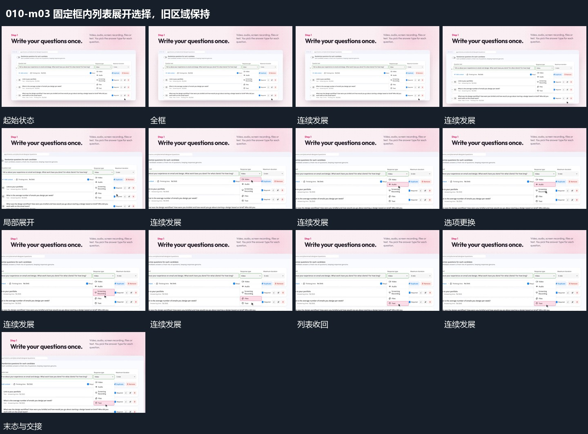

# 固定框内列表展开选择，旧区域保持

## 运动指令

保留外框与已出现行文，指示符到达局部后展开列表。选择下一项时列表内容更新，收回后只保留选中短项，其他区域不随之跳动。

## 视频切片

[播放本机制的原片切片](m03.mp4)

覆盖分镜中“全框”至“稳定结果”的连续过程，并保留邻近的前后衔接画面；原片中交叠发生的动作一并保留。

## 分镜过程

## 组合与调整

可改局部位置，保留定位再响应；避免整个框每次都重新淡入。
