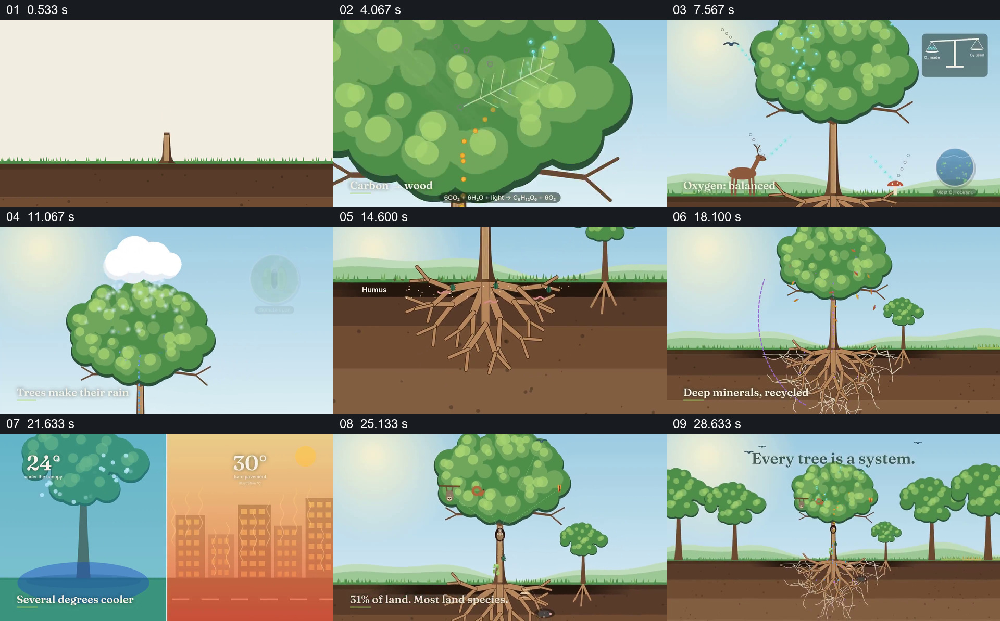

# 从同一棵树出发逐层揭示地上地下与周围环境

- 作品：案例 080《一棵树与周围系统》（本次概括）。
- 原片范围：00:00.000–00:31.616，含起点、不含终点；[完整原片](../video.mp4)｜[本卡片段](../video.mp4)。
- 观察方式：依据约每秒一次的真实源帧观察，未连续原速观看或听审；声音、语气与完整播放节奏未确认。

## 原画面具体怎样设计

画面从小树长成树冠和根系完整的大树，依次放大树叶、木材截面和地面上下；叶片上的图形与公式提示碳，水滴沿根部和树冠出现，画面也展示动物及氧气标识。地下根系扩展并与旁边的小树相接；随后树荫与城市热环境并列显示温度，树旁出现生物，最后拉远至林地、河流和城市，回到多棵树及地下根系，出现“每棵树都是一个系统”。

## 为什么这样设计，好在哪里

反复回到同一棵树，使叶、根、树荫与更大环境被看成有关联的局部；剖面和放大镜式切换让原本不可见的位置获得可观察的画面。公式、温度和生态数字是片中主张，需要科学核查。

以上为依据画面的分析，非作者自述；预期观看效果未经观众测试。

## 可直接使用的创意指令

介绍一个对象的多种环境关系时，先建立能反复返回的整体形象，再按真实依据切换到各个局部，展示输入、变化及周围对象；必要时用剖面揭示不可直接看到的位置，最后拉回整体说明这些关系如何共同构成系统。数值、因果与图示简化程度必须依据可靠资料。
