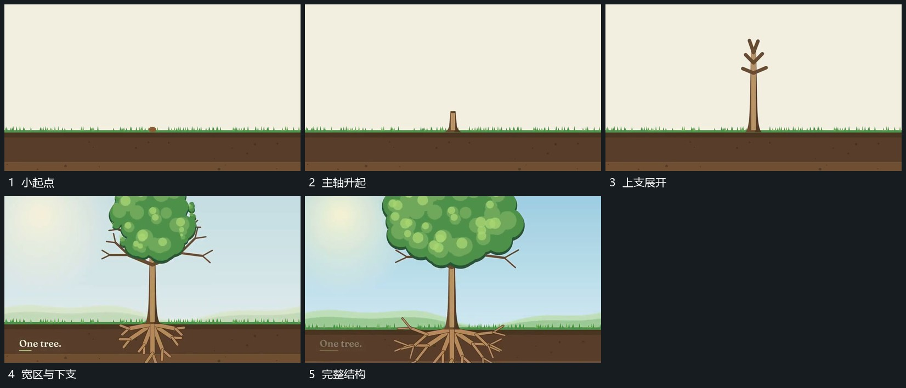

# 细长主形跨底线伸展并逐次长出分支

## 运动指令

从底线附近延长细长主轴，上端先向上伸展并逐次分出斜支。上部宽区随后向两侧展开，下方支路从同一主轴向下和侧下方延长。底线保持，最后形成上下相接的完整结构。

## 视频切片

[播放本机制的原片切片](m01.mp4)

覆盖分镜中“小起点”至“完整结构”的连续过程，并保留邻近的前后衔接画面；原片中交叠发生的动作一并保留。

## 分镜过程

## 组合与调整

可改变支路数量；各分支从已建立轴线派生，不能作为无来源片段同时弹出。
