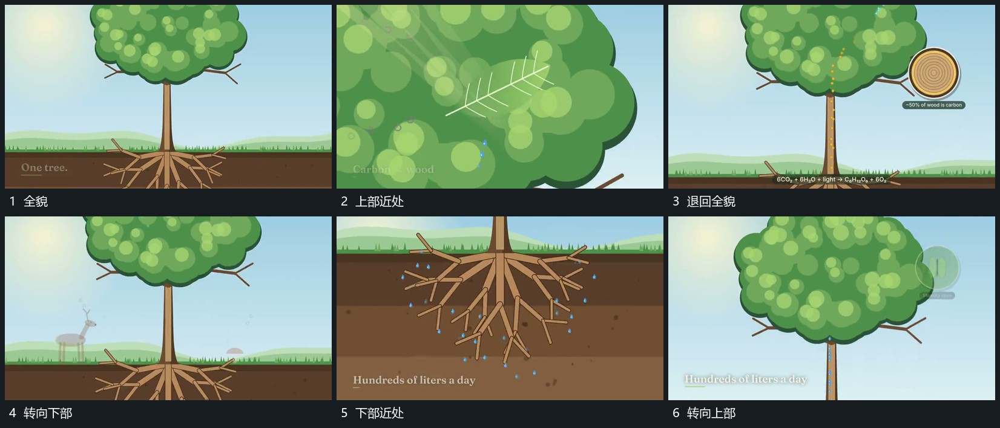

# 围同一主轴推入局部再沿纵向转移取景

## 运动指令

先推近上部局部，使外边界逐步越界，局部内部仍保持来源位置。退回全貌后沿主轴向下取景，露出底线以下的支路；需要返回上方时再沿同一轴上移。所有层随共同取景变化，局部小点继续流动。

## 视频切片

[播放本机制的原片切片](m02.mp4)

覆盖分镜中“全貌”至“转向上部”的连续过程，并保留邻近的前后衔接画面；原片中交叠发生的动作一并保留。

## 分镜过程

## 组合与调整

用主轴作为连续参照；无需每次完全退镜，可在同一尺度直接沿轴移动。
