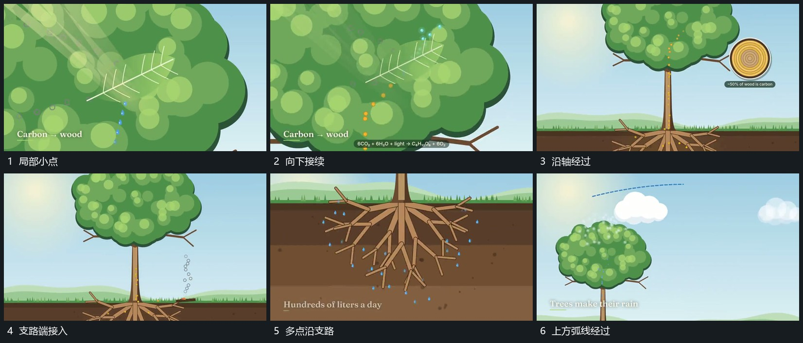

# 小点沿已有支路连续经过并接上局部圈

## 运动指令

让小点从已有支路端进入，沿轴线或弧线持续经过，中途不突然跳到另一支路。接近目标局部时补出小圆区或短标，路径本身保持。另一路可用不同方向经过，但错开起点，保留每条流动的来源与终点。

## 视频切片

[播放本机制的原片切片](m03.mp4)

覆盖分镜中“局部小点”至“上方弧线经过”的连续过程，并保留邻近的前后衔接画面；原片中交叠发生的动作一并保留。

## 分镜过程

## 组合与调整

可换任何路径，按可见路径迁移即可；不从小点运动推定真实过程或隐藏算法。
