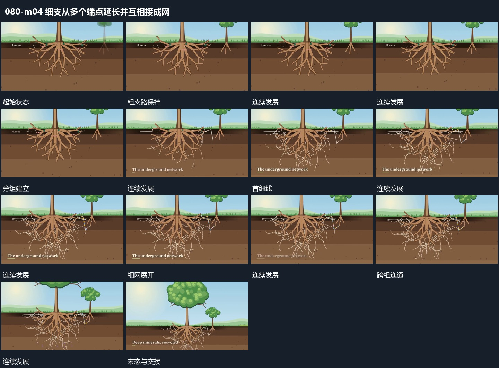

# 细支从多个端点延长并互相接成网

## 运动指令

保留粗支路，从多个末端向空处延长较细的线。细线不断分出短支，与相邻支路的细线相接，逐步形成跨组网络；已完成连接保持，不随新线加入而退去。最后让小点沿其中部分连接经过。

## 视频切片

[播放本机制的原片切片](m04.mp4)

保留起始准备、连续发展和完成或明确交接；首尾按本段运动范围裁切，不拼接、不变速。尾部只保留理解结果所需的展示。

## 分镜过程

## 组合与调整

连接数量按需要缩减；先有端点再延线，不把完整网络直接淡入。
