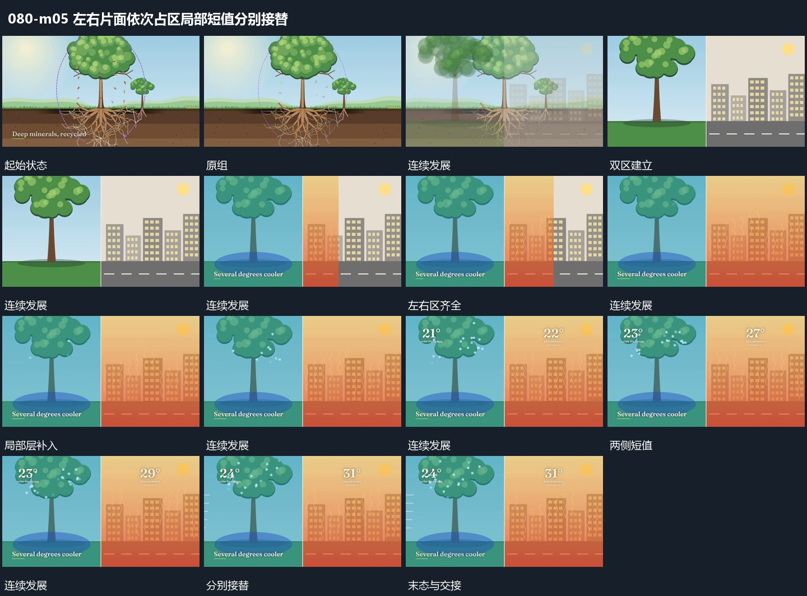

# 左右片面依次占区局部短值分别接替

## 运动指令

先让原组退让到一侧，另一片面从旁侧接入，形成明确的左右分区。两区边界保持，各自局部附加层先建立，短值随后在相同位置接替。变化只发生在本区内部，不让两区交替占满全幅。

## 视频切片

[播放本机制的原片切片](m05.mp4)

保留起始准备、连续发展和完成或明确交接；首尾按本段运动范围裁切，不拼接、不变速。尾部只保留理解结果所需的展示。

## 分镜过程

## 组合与调整

可用于并行运动比较；两区变化幅度分别决定，边界和参照位置保持稳定。
