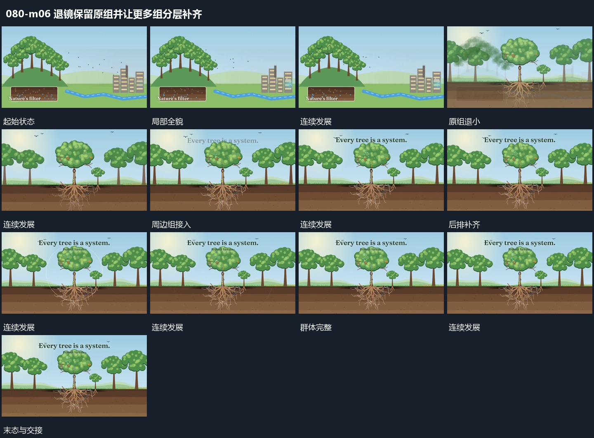

# 退镜保留原组并让更多组分层补齐

## 运动指令

从原组后退，让其缩小但持续位于中央附近。周边新组在退镜中从边缘与后层分次接入，前后排大小不同；原组的内部结构保留作为参照。群体齐全后在上方补短行，再共同保持。

## 视频切片

[播放本机制的原片切片](m06.mp4)

覆盖分镜中“局部全貌”至“结尾保持”的连续过程，并保留邻近的前后衔接画面；原片中交叠发生的动作一并保留。

## 分镜过程

## 组合与调整

可减少周边数量；新增组不能覆盖原组的身份，退镜应先给边缘留出范围。
