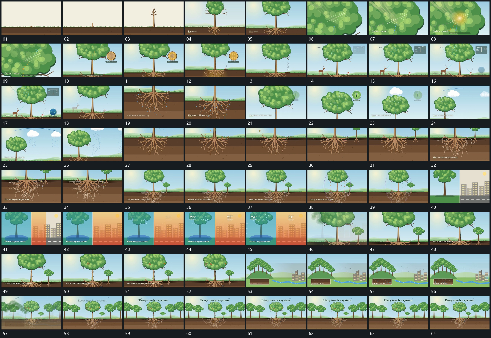

# 080｜原片运动总览

[观看完整原片](video.mp4)

## 运动总览

全片由细长主形跨底线伸展并逐次长出分支从底线附近生长出上下分支与上部展开区。随后围同一主轴推入局部再沿纵向转移取景推入上部局部，再退回全貌，并多次沿纵向转向下部和上部。小点沿已有支路连续经过并接上局部圈让小点沿已有枝状路径流动，支路与圆区保持。

下部新增细支使用细支从多个端点延长并互相接成网逐段延长并接成网状范围；上方弧线与下落短点仍复用小点沿已有支路连续经过并接上局部圈。中段左右片面依次占区局部短值分别接替让左右片面分开建立，再在两侧更新局部短值。最后退镜保留原组并让更多组分层补齐退镜露出更多并列组，保留原组作为中央参照并补结尾短行。

## 完整运动段落

以下按原片中的出现顺序引用。建立、内部发展及完成反馈放在同一段中；同时发生的局部动作与运镜写在同一份指令里。不同段之间可以是连续接管，也可以是直接切换，不能仅凭条目相邻认定可直接拼接。重复出现的同类运动采用一次连续代表范围，切片不以逐段无缝覆盖整片为目标。

1. [主轴生长分叉，推进与纵向移镜中亮点沿支路传递](mechanisms/m07.md)：主轴从底线长出分支，整体成形后推向局部；亮点沿已有支路运动并建立圈注，观看范围回到整体再纵向移动到另一层。

2. [细支从多个端点延长并互相接成网](mechanisms/m04.md)：端点延长后连通

3. [左右片面依次占区局部短值分别接替](mechanisms/m05.md)：分区建立后局部接替

4. [退镜保留原组并让更多组分层补齐](mechanisms/m06.md)：退镜与新增组交叠

切片保留起始准备、必要内部停顿和完成或明确交接；首尾省略无新发展的等待，持续运动不要求人为停住。以上基于真实源帧序列和重点边界核对，不等同于全片连续声画审片。

## 完整64宫格

