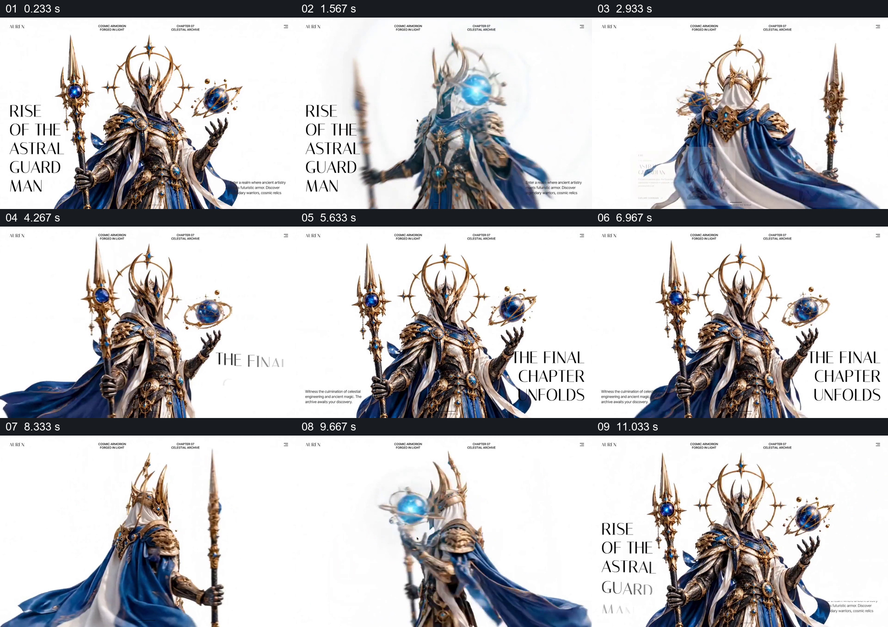

# 让角色转向带出正背面与页面文字变化

- 作品：案例 095《幻想角色页面展示》（本次概括）。
- 原片范围：00:00.000–00:12.167，含起点、不含终点；[完整原片](../video.mp4)｜[本卡片段](../video.mp4)。
- 观察方式：依据约每秒一次的真实源帧观察，未连续原速观看或听审；声音、语气与完整播放节奏未确认。

## 原画面具体怎样设计

白底页面中央是持长杖的金蓝铠甲角色，左侧有标题；手边蓝色光球变亮，角色转向背面，透明资料卡叠在下方。角色再转回正面，右侧出现新标题，随后再次转身并回到起始构图，页面顶栏保持。

## 为什么这样设计，好在哪里

正背面视角围绕同一角色展开，使造型细节有明确对应；文字与资料卡随视角让出主体，背景和顶部栏稳定维持页面整体。抽帧不能确认转身是否为连续三维运动。

以上为依据画面的分析，非作者自述；预期观看效果未经观众测试。

## 可直接使用的创意指令

展示复杂角色或物件时，先建立正面及可识别的关键配件，再切换到背面或侧面，并将相关信息放在不遮挡主体的位置；返回整体时保留一致的页面参照。视角变化应根据真实素材能力安排。
