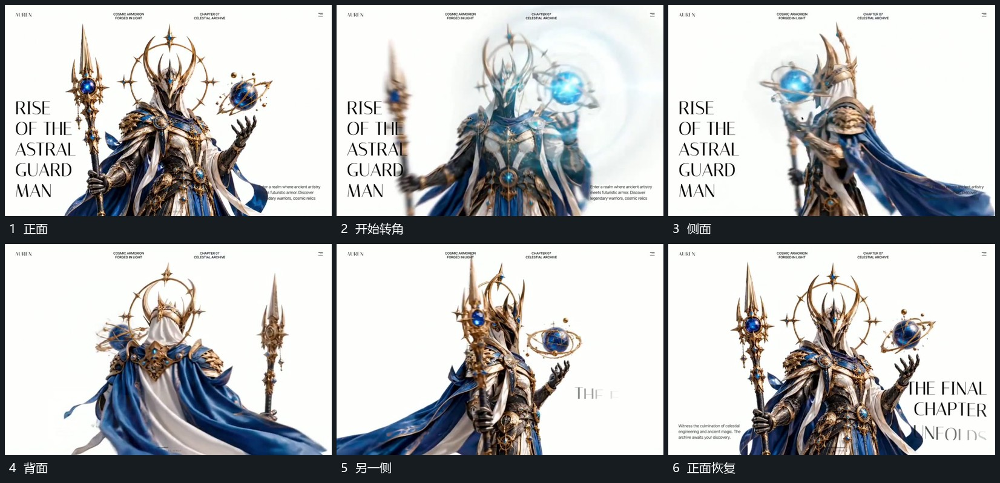

# 主组连续转向正侧背面附属长片滞后摆动

## 运动指令

保持主组中心范围，连续改变观察角度，依次露出正面、侧面和背面。附属长片在转向中仍连接原处，远端稍后跟上并持续摆动；转回正面后收小整体转角，附属层保留局部余动。

## 视频切片

[播放本机制的原片切片](m01.mp4)

覆盖分镜中“正面”至“正面恢复”的连续过程，并保留邻近的前后衔接画面；原片中交叠发生的动作一并保留。

## 分镜过程

## 组合与调整

可只转到侧面再返回；附属层不能随每次转角重新生成不同来源。
