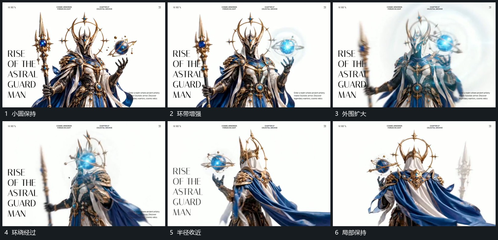

# 小圆外围环带在转向中扩大并绕行后收近

## 运动指令

保留主组旁的小圆，让外围细环围圆持续转向，环面倾角略有差异。某一层先扩大半径，后层随之接上，随后逐渐收近；主组整体转向仍继续，环始终围同一小圆。

## 视频切片

[播放本机制的原片切片](m02.mp4)

覆盖分镜中“小圆保持”至“局部保持”的连续过程，并保留邻近的前后衔接画面；原片中交叠发生的动作一并保留。

## 分镜过程

## 组合与调整

减少环数即可迁移；半径变化只作用于局部环带，不同步放大整组。
