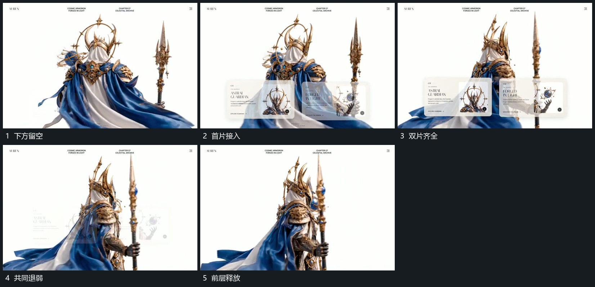

# 两张小片面并列接入后共同退去

## 运动指令

在主组下方先接入一张小片面，第二张随后在旁侧接上，两片保持并列边界。内部短行与局部图块随片建立，短暂共同保持后两片一起退弱退出；主组的转向不中断。

## 视频切片

[播放本机制的原片切片](m04.mp4)

覆盖分镜中“下方留空”至“前层释放”的连续过程，并保留邻近的前后衔接画面；原片中交叠发生的动作一并保留。

## 分镜过程

## 组合与调整

可以只用一片，作用范围保持在原空处；不要把片面退去误写成主体消失。
