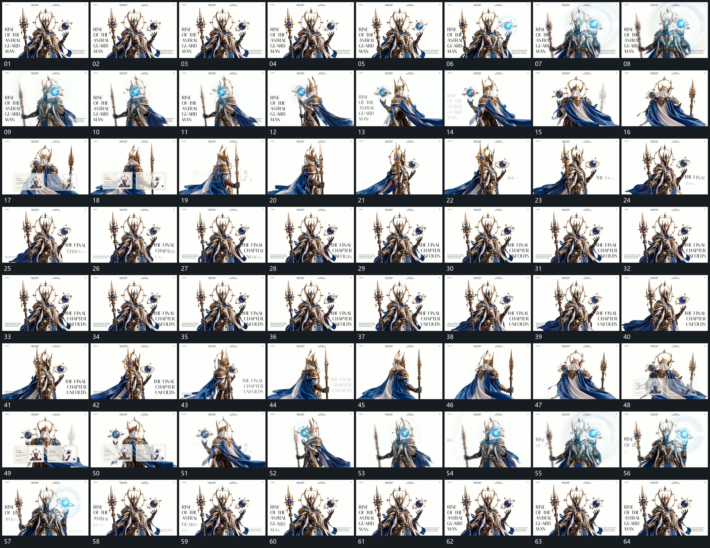

# 095｜原片运动总览

[观看完整原片](video.mp4)

## 运动总览

全片保持同一主组，主组连续转向正侧背面附属长片滞后摆动围组形连续改变正侧背面，附属长片始终有局部摆动。小圆外围环带在转向中扩大并绕行后收近在主组旁的小圆周围增加环带，并在转向中扩大又收近。

前层内容以侧边字列分行建立保持后整体退弱分行建立、保持再退去，必要时两张小片面并列接入后共同退去加入并列小片面后共同退出。正面与背面来回时重复使用同一组机制，结尾回到首段字列与原主组位置。

## 完整运动段落

以下按原片中的出现顺序引用。建立、内部发展及完成反馈放在同一段中；同时发生的局部动作与运镜写在同一份指令里。不同段之间可以是连续接管，也可以是直接切换，不能仅凭条目相邻认定可直接拼接。重复出现的同类运动采用一次连续代表范围，切片不以逐段无缝覆盖整片为目标。

1. [主组连续转角，外围圆环与并置片交叠接入后由旁字收尾](mechanisms/m05.md)：主组绕轴转向不同侧面，外围小圆在转向中扩环绕行并收近；两张小片并置接入后退出，旁字逐行建立，最后整体退弱。

切片保留起始准备、必要内部停顿和完成或明确交接；首尾省略无新发展的等待，持续运动不要求人为停住。以上基于真实源帧序列和重点边界核对，不等同于全片连续声画审片。

## 完整64宫格

