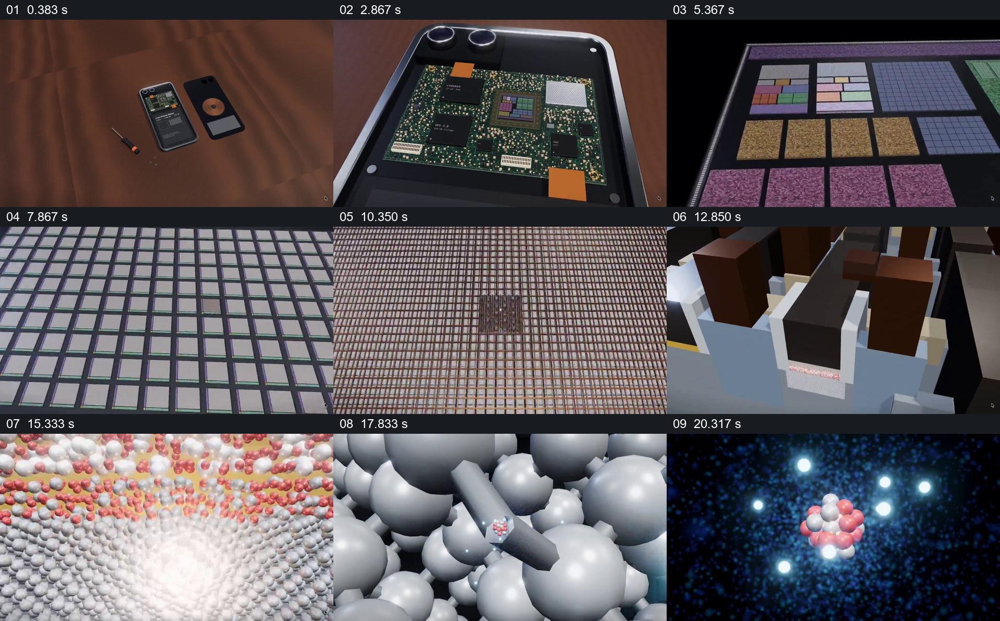

# 从日常设备逐级进入微观世界

- 作品：案例 100《从手机进入芯片与微观结构》（本次概括）。
- 原片范围：00:00.000–00:22.430，含起点、不含终点；[完整原片](../video.mp4)｜[本卡片段](../video.mp4)。
- 观察方式：依据约每秒一次的真实源帧观察，未连续原速观看或听审；声音、语气与完整播放节奏未确认。

## 原画面具体怎样设计

木桌上手机后盖与工具分开，镜头靠近内部电路板，再进入彩色芯片区域；方格阵列被进一步放大，逐渐显出密集立体结构，最后转到由球体组成的微观模型及深色空间中的粒子组合。画面以持续接近的观察方式连接各级尺度。

## 为什么这样设计，好在哪里

从熟悉的手机入手，连续放大建立每一级观察与上一层的关系，使不可直观看到的尺度变化具有路径。微观形象是动画模型，不能当成真实摄影或直接证明物理结构。

以上为依据画面的分析，非作者自述；预期观看效果未经观众测试。

## 可直接使用的创意指令

表现日常设备的多级尺度时，先展示能辨识的整体与内部目标，再依据可靠结构资料依次放大各层，维持清楚的包含关系；进入模型或艺术化微观画面时明确其示意性质，避免把视觉连续等同于真实成像。
