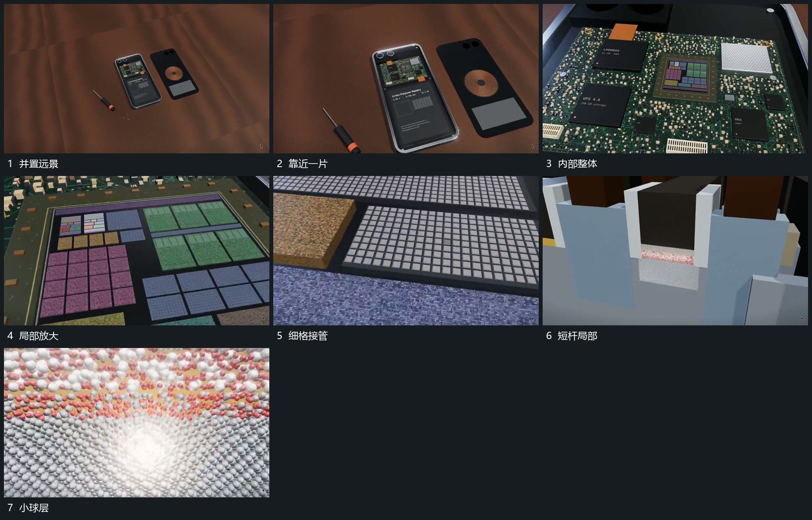

# 从并置全貌锁定一片连续推入多级局部

## 运动指令

从双片全貌中锁定一片持续靠近，外框逐步越界，内部小组接管取景。再选择其中一个区块继续推入，更细的格阵和短杆逐级露出；每一级都保留少量上一层边界，中心来源连续。

## 视频切片

[播放本机制的原片切片](m01.mp4)

覆盖分镜中“并置远景”至“小球层”的连续过程，并保留邻近的前后衔接画面；原片中交叠发生的动作一并保留。

## 分镜过程

## 组合与调整

可以减少层级；路径要先确定下一局部入口，不用随机跳镜冒充持续放大。
