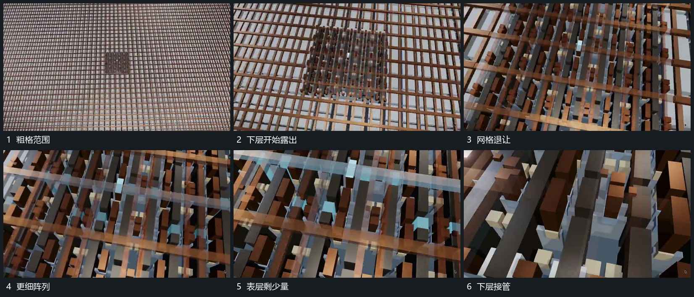

# 上方格状层退让下方短杆阵列接管

## 运动指令

靠近格状表层后让近侧格层逐步退让，下方短杆阵列从同一位置露出。保留几条原格边作参照，细阵列占据主要范围后旧格层再退出，取景继续靠近其中一个短杆组。

## 视频切片

[播放本机制的原片切片](m02.mp4)

覆盖分镜中“粗格范围”至“下层接管”的连续过程，并保留邻近的前后衔接画面；原片中交叠发生的动作一并保留。

## 分镜过程

## 组合与调整

可用透明退让或外移实现；不把原片外观解释为真实结构证明。
