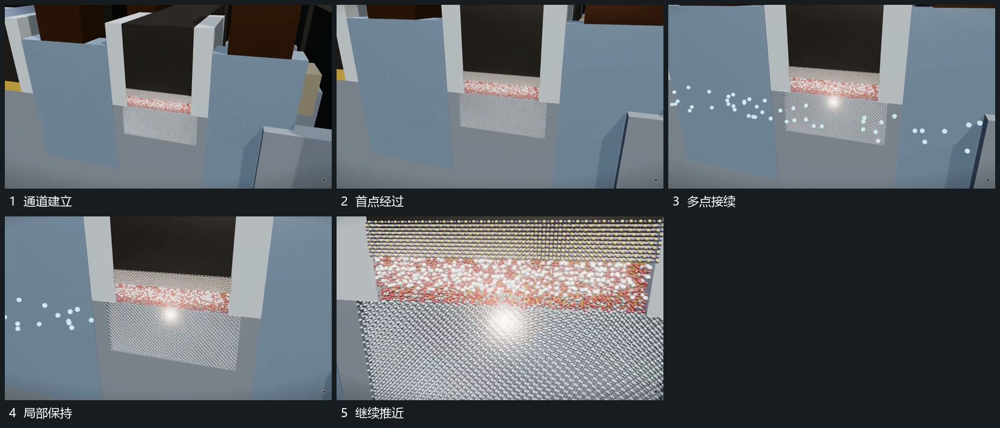

# 小点沿局部通道连续经过并越出一侧

## 运动指令

固定通道两侧边界，让小点从一端分次进入，沿中间空区持续经过并从另一侧离开。不同点保持大致方向，间距略有变化；取景靠近时流动不中断，点不跳到边界之外的无关位置。

## 视频切片

[播放本机制的原片切片](m03.mp4)

覆盖分镜中“通道建立”至“继续推近”的连续过程，并保留邻近的前后衔接画面；原片中交叠发生的动作一并保留。

## 分镜过程

## 组合与调整

密度按需要减少，保证运动方向可辨；不声称原片真实粒子行为。
