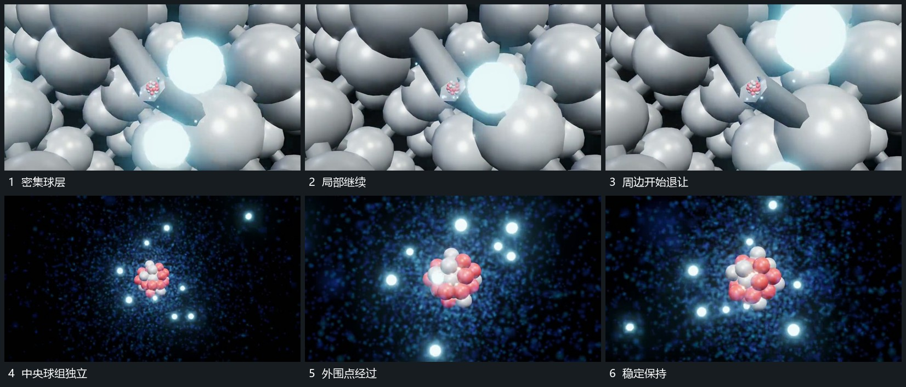

# 周边连接退去中央球组留下外围点继续经过

## 运动指令

保留一个中央小球组，周围球阵与连接逐步退去，露出更空的后层。外围小点仍从不同位置经过中央附近，并在远处退弱；中央组只作小幅转角，取景到稳定比例后保持。

## 视频切片

[播放本机制的原片切片](m04.mp4)

覆盖分镜中“密集球层”至“稳定保持”的连续过程，并保留邻近的前后衔接画面；原片中交叠发生的动作一并保留。

## 分镜过程

## 组合与调整

外围点可少量保留，中央组身份不变；释放密集层时不要把中央也清空再重建。
