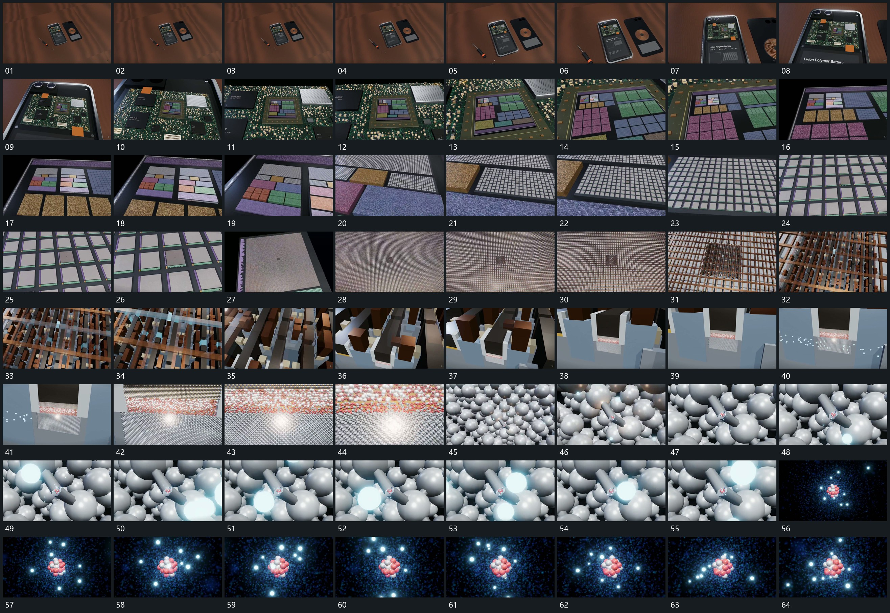

# 100｜原片运动总览

[观看完整原片](video.mp4)

## 运动总览

全片从双片并置的远景开始，从并置全貌锁定一片连续推入多级局部连续推向一片内部，再逐级进入网格、短杆和小球阵列。靠近中层时上方格状层退让下方短杆阵列接管退让上方格状层，露出下部小组；小点沿局部通道连续经过并越出一侧让小点沿同一局部通道连续经过。

到更细球层后继续复用从并置全貌锁定一片连续推入多级局部，进入其中一处短连接。末段周边连接退去中央球组留下外围点继续经过把周围连接与球层退去，只留中央小球组，外围小点围其持续经过，取景到稳定范围后保持。

## 完整运动段落

以下按原片中的出现顺序引用。建立、内部发展及完成反馈放在同一段中；同时发生的局部动作与运镜写在同一份指令里。不同段之间可以是连续接管，也可以是直接切换，不能仅凭条目相邻认定可直接拼接。重复出现的同类运动采用一次连续代表范围，切片不以逐段无缝覆盖整片为目标。

1. [从并置全景逐层推入，格层退让后沿通道展示流动](mechanisms/m05.md)：锁定并置中的一片逐层推近，上层网格退让使下方短杆阵列接管；继续沿局部通道靠近，内部小点流动并越出一侧。

2. [周边连接退去中央球组留下外围点继续经过](mechanisms/m04.md)：释放周边保留中央

切片保留起始准备、必要内部停顿和完成或明确交接；首尾省略无新发展的等待，持续运动不要求人为停住。以上基于真实源帧序列和重点边界核对，不等同于全片连续声画审片。

## 完整64宫格

