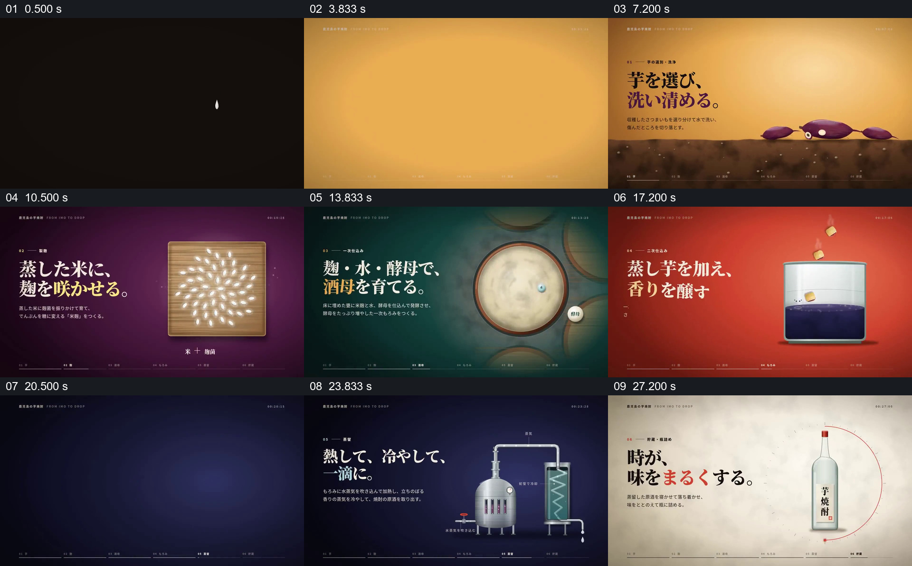

# 把原料到成品的变化编成连续工艺图

- 作品：案例 084《甘薯烧酒的制作》（本次概括）。
- 原片范围：00:00.000–00:30.000，含起点、不含终点；[完整原片](../video.mp4)｜[本卡片段](../video.mp4)。
- 观察方式：依据约每秒一次的真实源帧观察，未连续原速观看或听审；声音、语气与完整播放节奏未确认。

## 原画面具体怎样设计

日落与山形建立标题后，画面换成土壤上的甘薯并显示清洗文字与水线；接着紫色页面呈现米粒和制曲，绿色页面用圆形容器与标签表示曲、水、酵母，红色页面把蒸过的甘薯加入容器。深色页面展示连接冷却管的蒸馏装置，液滴落下，最后转为浅底上的成品瓶与文字。每一步有独立颜色和简短说明。

## 为什么这样设计，好在哪里

每个阶段保留可识别的材料或器具，并用一致的版式连接不同颜色页面，使过程既可逐步辨认也能通读为原料到成品。工艺解释以片中所示为准，未独立核验。

以上为依据画面的分析，非作者自述；预期观看效果未经观众测试。

## 可直接使用的创意指令

介绍真实制作工艺时，按经核对的工序选择各阶段关键材料、容器和状态，用简短文字说明本步发生的变化；让前一步产物成为后一步输入，最后展示成品。色彩、画面和节奏可改变，但工艺次序与条件必须对应来源。
