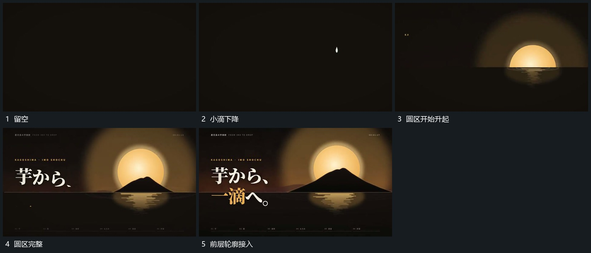

# 小滴落到平面圈形展开圆区随后上升

## 运动指令

让小滴从上方落向水平面，接近落点时在下方展开横向圈带。落点附近的圆区随后从平面后向上升起，前层小轮廓在其下缘接入；圈带保留于平面附近，不随圆区一起上移。

## 视频切片

[播放本机制的原片切片](m01.mp4)

覆盖分镜中“留空”至“前层轮廓接入”的连续过程，并保留邻近的前后衔接画面；原片中交叠发生的动作一并保留。

## 分镜过程

## 组合与调整

可更换落点与前层形，保留下落、扩散、升起的先后关系。
