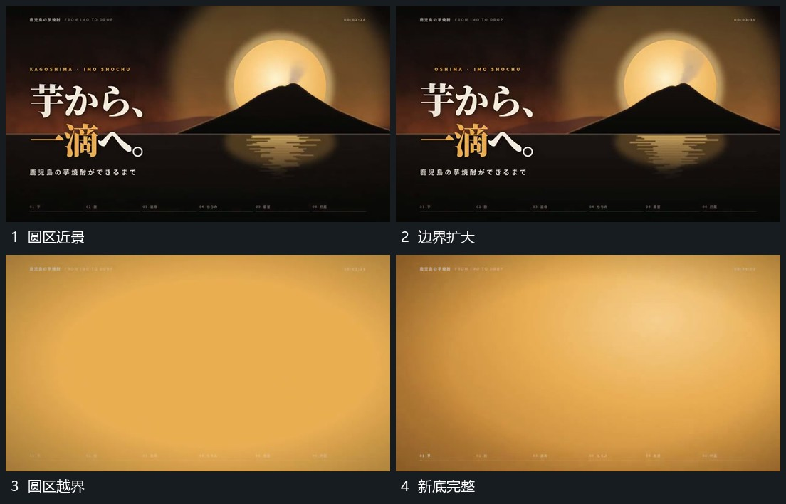

# 推入圆区使边界越界接管全幅

## 运动指令

沿圆区中心推近，圆区与前方轮廓逐步放大，外围字行随共同取景移出。圆边界越过画面后保留其内部范围作为新底，下一组从空处接入；推进中不突然改变中心。

## 视频切片

[播放本机制的原片切片](m02.mp4)

覆盖分镜中“圆区近景”至“新底完整”的连续过程，并保留邻近的前后衔接画面；原片中交叠发生的动作一并保留。

## 分镜过程

## 组合与调整

适合从局部换到新底；让新组在覆盖完成附近进入，不在上一圆边界仍小的时候硬切。
