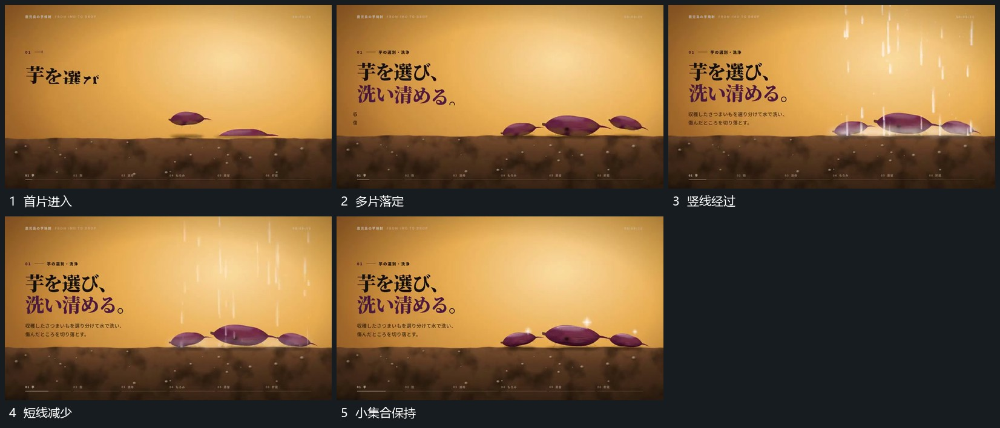

# 小片从上方错开落定短竖线随后经过

## 运动指令

让几片扁形从上方错开进入，下落中改变小倾角，落到承载面后保持。集合齐全后让多条短竖线从上方向下经过，线与片的接近处短暂出现细点，再退去；片的位置与承载面不动。

## 视频切片

[播放本机制的原片切片](m03.mp4)

覆盖分镜中“首片进入”至“小集合保持”的连续过程，并保留邻近的前后衔接画面；原片中交叠发生的动作一并保留。

## 分镜过程

## 组合与调整

可减少竖线数量；先落定片层，再让外围经过，避免同时建立两组主动作。
