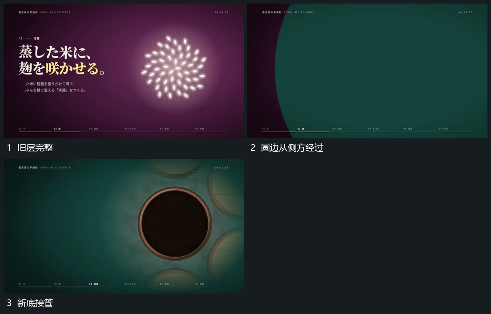

# 大圆边界横向经过覆盖原层并换底

## 运动指令

从画面一侧推进大圆覆盖层，弧形边界横向经过旧组，旧组被依次遮住。新底随覆盖区露出，中央新圆区在覆盖过程中建立；覆盖边界越出另一侧后，新组完整保持。

## 视频切片

[播放本机制的原片切片](m05.mp4)

覆盖分镜中“旧层完整”至“新底接管”的连续过程，并保留邻近的前后衔接画面；原片中交叠发生的动作一并保留。

## 分镜过程

## 组合与调整

圆边可换其他弧形，保留同向经过；不要让旧层先整组淡出再移动覆盖层。
