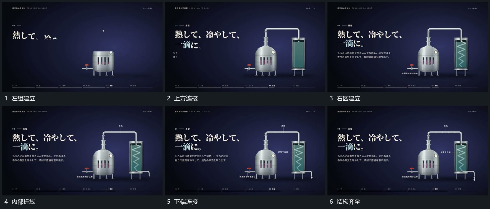

# 外部连通轮廓先延长内部折线再逐段描出

## 运动指令

先建立左组，从其上端延长细线，横向经过后向下接到右侧空区。右区轮廓闭合后，从顶部向下逐段描出内部折线，最后接上底部短出口。小点沿已完成路径经过，外边界保持。

## 视频切片

[播放本机制的原片切片](m08.mp4)

覆盖分镜中“左组建立”至“结构齐全”的连续过程，并保留邻近的前后衔接画面；原片中交叠发生的动作一并保留。

## 分镜过程

## 组合与调整

可改变折线路径，先接通外结构再增加内部；断点处不可凭空跳接。
