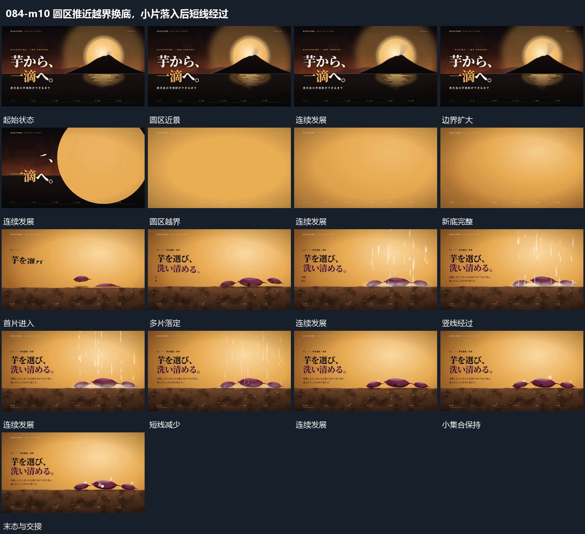

# 圆区推近越界换底，小片落入后短线经过

## 运动指令

推近原圆形区域直到边缘越界，新底层接管；上方小片错开落到固定位置，短竖线随后经过完成内部活动。

1. **推入圆区使边界越界接管全幅**

沿圆区中心推近，圆区与前方轮廓逐步放大，外围字行随共同取景移出。圆边界越过画面后保留其内部范围作为新底，下一组从空处接入；推进中不突然改变中心。

2. **小片从上方错开落定短竖线随后经过**

让几片扁形从上方错开进入，下落中改变小倾角，落到承载面后保持。集合齐全后让多条短竖线从上方向下经过，线与片的接近处短暂出现细点，再退去；片的位置与承载面不动。

整段结束：小片落定且竖线退去 保留必要落稳与交接，中间已建立的参照沿用到下一步骤。

## 视频切片

[播放本机制的原片切片](m10.mp4)

保留起始准备、连续发展和完成或明确交接；首尾按本段运动范围裁切，不拼接、不变速。相连的小动作合为同一完整段落。

## 分镜过程

## 组合与调整

推近原圆形区域直到边缘越界，新底层接管；上方小片错开落到固定位置，短竖线随后经过完成内部活动。 复用时可调整元素数量、幅度和相对节奏，保留上述进入、交叠与完成关系；不直接沿用原片题材或时长。

适合从局部换到新底；让新组在覆盖完成附近进入，不在上一圆边界仍小的时候硬切。

可减少竖线数量；先落定片层，再让外围经过，避免同时建立两组主动作。
