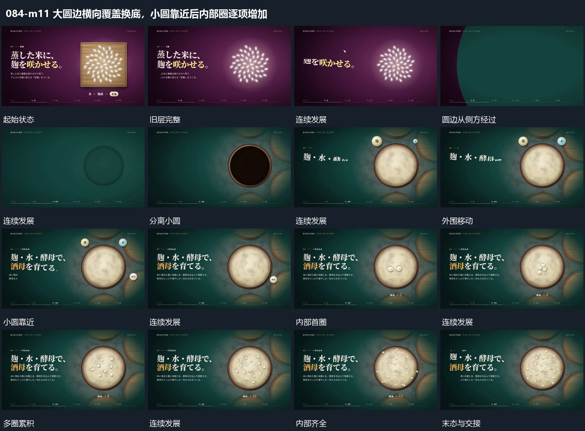

# 大圆边横向覆盖换底，小圆靠近后内部圈逐项增加

## 运动指令

大圆边经过完成新底层交接，中央大圆建立，周边小圆靠近，内部小圈继续逐项增加完成集合。

1. **大圆边界横向经过覆盖原层并换底**

从画面一侧推进大圆覆盖层，弧形边界横向经过旧组，旧组被依次遮住。新底随覆盖区露出，中央新圆区在覆盖过程中建立；覆盖边界越出另一侧后，新组完整保持。

2. **小圆围大圆靠近接入内部小圈逐次增加**

让外围几个小圆沿中央圆周改变位置，逐个向中央边界靠近。接近后外围圆退去，内部从少量小圈开始逐次增加，已有圈保留并改变少量位置。大圆边界保持，下方短值可随增加原位接替。

整段结束：内部多个小圈累积 保留必要落稳与交接，中间已建立的参照沿用到下一步骤。

## 视频切片

[播放本机制的原片切片](m11.mp4)

保留起始准备、连续发展和完成或明确交接；首尾按本段运动范围裁切，不拼接、不变速。相连的小动作合为同一完整段落。

## 分镜过程

## 组合与调整

大圆边经过完成新底层交接，中央大圆建立，周边小圆靠近，内部小圈继续逐项增加完成集合。 复用时可调整元素数量、幅度和相对节奏，保留上述进入、交叠与完成关系；不直接沿用原片题材或时长。

圆边可换其他弧形，保留同向经过；不要让旧层先整组淡出再移动覆盖层。

内部累积与外圈靠近要有先后联系；不推定数量增长的隐藏规则。
