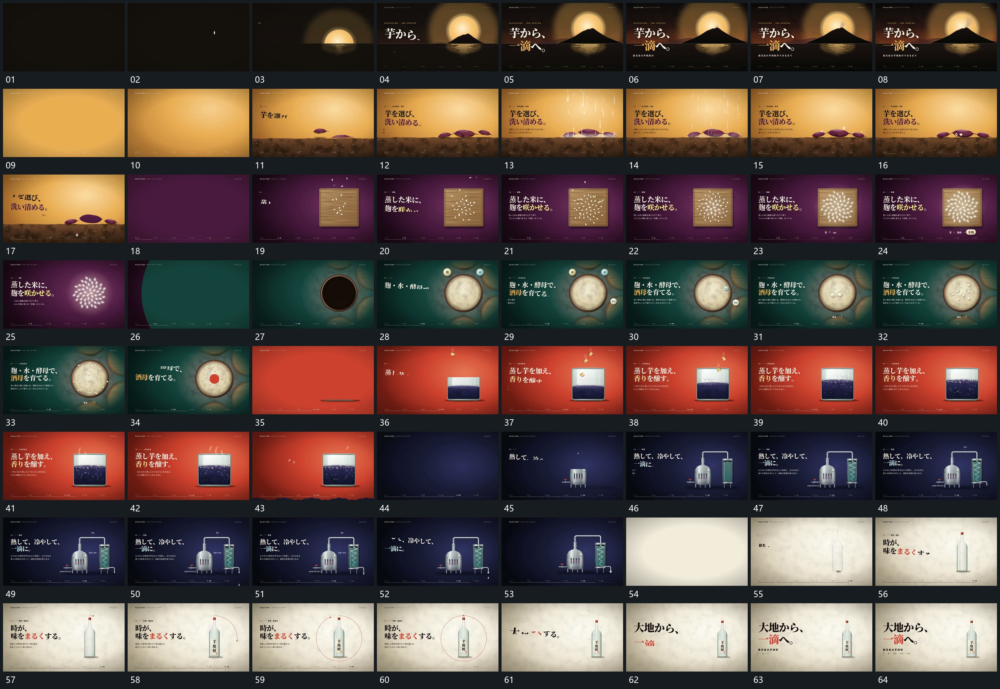

# 084｜原片运动总览

[观看完整原片](video.mp4)

## 运动总览

全片先由小滴落到平面圈形展开圆区随后上升的小滴下落与圈形展开引出上升圆区，随后推入圆区使边界越界接管全幅推入圆区，使其越界接管新底。小片从上方错开落定短竖线随后经过在固定横向承载面上分次送入小片，短竖线随后从上方经过。

下一段细小片落入方区累积外框退去留下集合让细小片从上方落入方形范围并累积；外框退去，内部集合留下。大圆边界横向经过覆盖原层并换底以大圆边界横向覆盖换底，接入小圆围大圆靠近接入内部小圈逐次增加的小圆围绕大圆靠近、内部小圈逐次增加。后段方块从上方落入下区并伴随区域增高把方块送入下区并让下区增高，再接外部连通轮廓先延长内部折线再逐段描出的连通轮廓与内部折线逐段建立。结尾换底后细长形建立，围细长形描出完整圆圈字行分段建立沿其外围描圈，旁侧字行分段补齐。

## 完整运动段落

以下按原片中的出现顺序引用。建立、内部发展及完成反馈放在同一段中；同时发生的局部动作与运镜写在同一份指令里。不同段之间可以是连续接管，也可以是直接切换，不能仅凭条目相邻认定可直接拼接。重复出现的同类运动采用一次连续代表范围，切片不以逐段无缝覆盖整片为目标。

1. [小滴落到平面圈形展开圆区随后上升](mechanisms/m01.md)：下落扩散后上升

2. [圆区推近越界换底，小片落入后短线经过](mechanisms/m10.md)：推近原圆形区域直到边缘越界，新底层接管；上方小片错开落到固定位置，短竖线随后经过完成内部活动。

3. [细小片落入方区累积外框退去留下集合](mechanisms/m04.md)：逐片落入后释放边界

4. [大圆边横向覆盖换底，小圆靠近后内部圈逐项增加](mechanisms/m11.md)：大圆边经过完成新底层交接，中央大圆建立，周边小圆靠近，内部小圈继续逐项增加完成集合。

5. [方块从上方落入下区并伴随区域增高](mechanisms/m07.md)：下落累积与内部运动交叠

6. [外部连通轮廓先延长内部折线再逐段描出](mechanisms/m08.md)：外部接通后内部展开

7. [围细长形描出完整圆圈字行分段建立](mechanisms/m09.md)：描圈后字行接续

切片保留起始准备、必要内部停顿和完成或明确交接；首尾省略无新发展的等待，持续运动不要求人为停住。以上基于真实源帧序列和重点边界核对，不等同于全片连续声画审片。

## 完整64宫格

