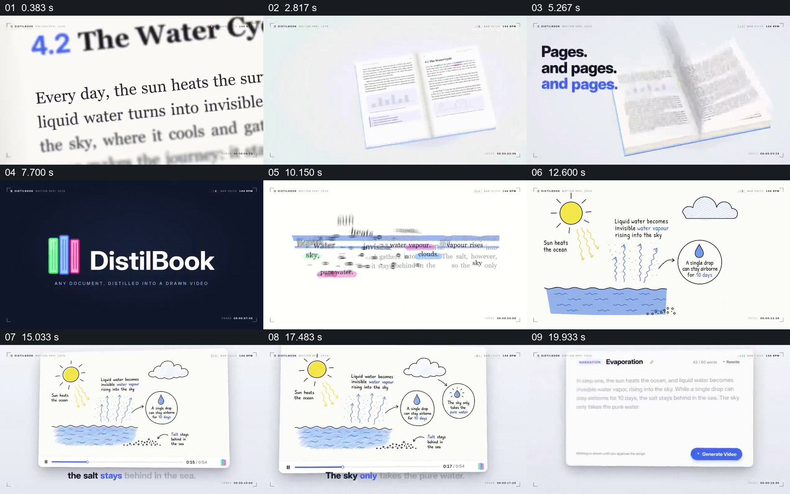

# 用同一段文章引出图解并回到可编辑文字

- 作品：案例 057《将文章变成水循环图解视频》（索引名称）。
- 原片范围：00:00.000–00:22.000，含起点、不含终点；[完整原片](../video.mp4)｜[本卡片段](c01.mp4)。
- 观察方式：依据整片 64 宫格和约每秒一次的真实源帧观察，未连续原速观看或听审；声音、语气与完整播放节奏未确认。

## 原画面具体怎样设计

画面先放大水循环文字，部分词语用不同颜色高亮；书页翻动后回到该段文字。太阳、海洋、上升水汽和云逐步组成手绘图，视频播放器下方出现字幕；随后弹出可编辑的文字框和生成按钮。

## 为什么这样设计，好在哪里

同一主题从文字转到画面，让读者可以对应原句与图解对象；编辑入口保留了修改文字的位置。画面不证明生成准确或字幕与声音已对齐。

以上为依据画面的分析，非作者自述；预期观看效果未经观众测试。

## 可直接使用的创意指令

当把资料转成解释画面时，选取可靠且有授权的原文，标出关键对象和关系，再用图形按真实过程建立；提供文本与原文核对及修改入口，检查科学内容、声音和字幕一致性。
