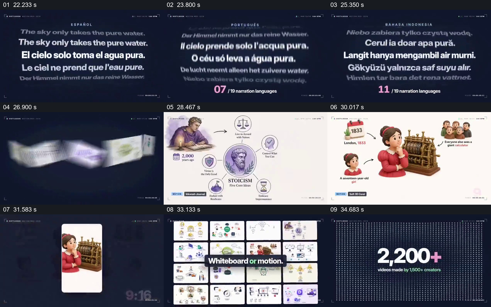

# 从同一句话的语言变化扩展到不同画面样例

- 作品：案例 057，文章转图解视频（库内案例）。
- 原片范围：00:22–00:36；[原片](../video.mp4)｜[片段](c02.mp4)。含起点、不含终点。
- 观察方式：全片 64 格与本卡九宫格；未独立连续原速观看、听审。语言翻译及画面中的数量、产品能力未经核验。

## 原画面具体怎样设计

深蓝背景中央堆叠同一句“天空只带走纯水”的不同语言文本；中间一行较亮、较大，上下行渐暗，顶部语言名称和下方“07/19”等计数随所示语言变化。之后进入一排白底图解样例：哲学人物与观念图、设备图、人物故事等依次成为观看对象，人物样例又被放入竖屏框并标出 9:16。

接着大量白底样例排成矩阵，中间覆盖“Whiteboard or motion.”；样例缩成密集点阵，大数字给出“2,200+”及创作者数量。局部例子的内容可以识别，汇总画面则让数量成为主体。片末品牌单独收束，不纳入本卡。

## 为什么这样设计，好在哪里

多语言阶段固定句子的含义，把观看重点放在语言变化上；随后从能看清的单个样例拉到矩阵，再由矩阵接到数字，使“不同形式”和“数量”分别有直观参照。若一开始只有大数字，观众不知道被计数的是什么；若只有一个样例，则难以感知风格与画幅的范围。样例墙与数字属于展示宣称，不能单凭画面推断支持能力或统计真实性。

## 可直接使用的创意指令

先挑选一条准确、可核实的共同内容，排列其经过复核的多语言版本，明确哪一行正被关注；再展示若干真实且有代表性的不同题材、画风或画幅样例，让观众读到单例之后再汇聚为集合。需要呈现数量时，写明统计口径与来源，数字与集合应对应。具体卡片样式、语言和主题可替换；保留共同内容作为比较基础及“可读单例→可见范围→数量”的关系。
