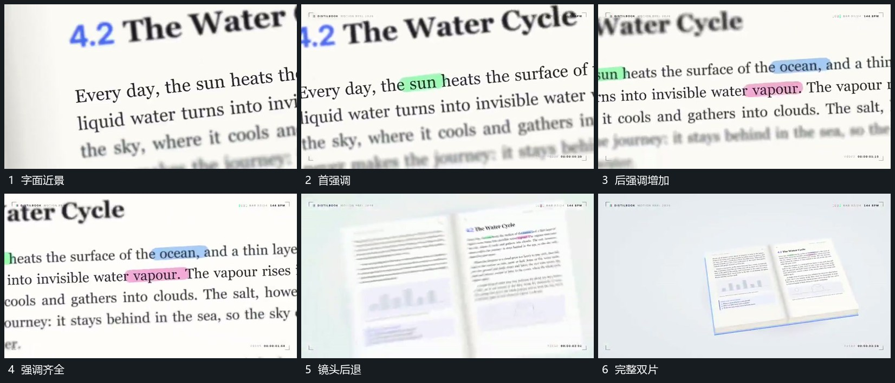

# 近景字面逐项建立强调，退镜后保留字面为整体片

## 运动指令

在字面近景中逐项建立局部强调，已强调部分保持。完成后后退显出完整片面与相邻片，强调仍留在原字面位置，形成局部到整体的连续关系。

## 视频切片

[播放本机制的原片切片](m01.mp4)

覆盖分镜中“字面近景”至“完整双片”的连续过程，并保留邻近的前后衔接画面；原片中交叠发生的动作一并保留。

## 分镜过程

## 组合与调整

可换任何字面或细节材料，不继承原文字内容。
