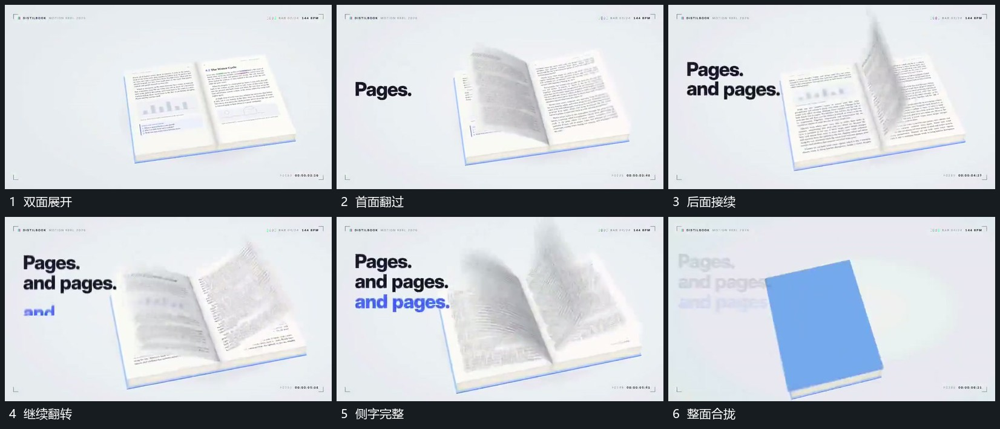

# 多层平面绕中轴依次翻过，侧字分行增加后整面合拢

## 运动指令

保留共同中轴，让多层平面依次翻过，前面接到另一侧后后面继续。侧字分行增加，前行保持；末尾将整组平面合拢成单片，再交给下一标记组。

## 视频切片

[播放本机制的原片切片](m02.mp4)

覆盖分镜中“双面展开”至“整面合拢”的连续过程，并保留邻近的前后衔接画面；原片中交叠发生的动作一并保留。

## 分镜过程

## 组合与调整

不要求原片书本结构，用平面堆叠也可实现，重点是同轴连续接力。
