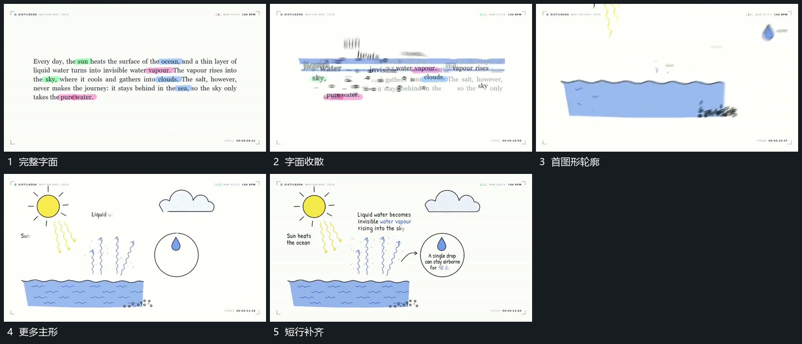

# 字面收散，原区域图形轮廓分批补出

## 运动指令

让完整字面向局部收散，旧字逐步退出主要位置。在原承载区域分批补出图形轮廓，先主要形再次要形，短行与标记随后接入，使两类承载连续交接。

## 视频切片

[播放本机制的原片切片](m03.mp4)

覆盖分镜中“完整字面”至“短行补齐”的连续过程，并保留邻近的前后衔接画面；原片中交叠发生的动作一并保留。

## 分镜过程

## 组合与调整

不假定文字真实变成物体，用清楚的位置接续保留同样运动关系。
