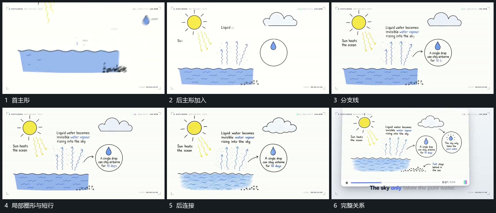

# 主形先建立，分支线和局部圈依次补齐

## 运动指令

先建立几个主要形，再延伸分支线连接已出现部分。局部圈形接在相应分支旁，内部小形与短行随后补齐；前项保持，最后形成完整关系组。

## 视频切片

[播放本机制的原片切片](m04.mp4)

覆盖分镜中“首主形”至“完整关系”的连续过程，并保留邻近的前后衔接画面；原片中交叠发生的动作一并保留。

## 分镜过程

## 组合与调整

只有真实相连部分才画线，避免同时描出全部细节而失去推进。
