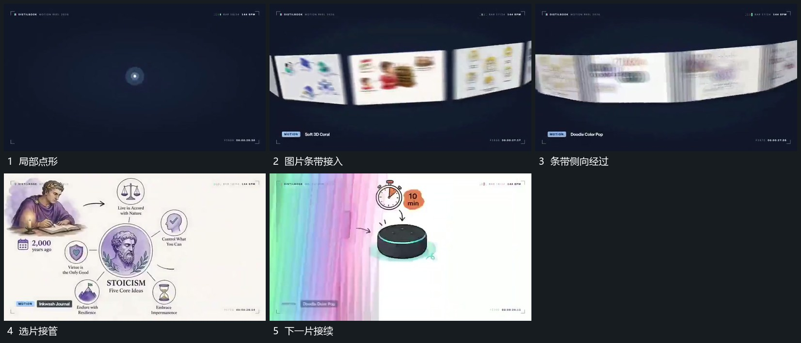

# 图片条带沿弧面侧向经过，选定平面接管满幅

## 运动指令

建立沿弧面排列的图片条带，让各片侧向经过，近片较大，边缘片带转角。选定片逐渐转正并接管满幅，后续片可沿相同方向继续接替。

## 视频切片

[播放本机制的原片切片](m06.mp4)

覆盖分镜中“局部点形”至“下一片接续”的连续过程，并保留邻近的前后衔接画面；原片中交叠发生的动作一并保留。

## 分镜过程

## 组合与调整

保留选片来源，条带可减片数，不推定真实曲面模型。
