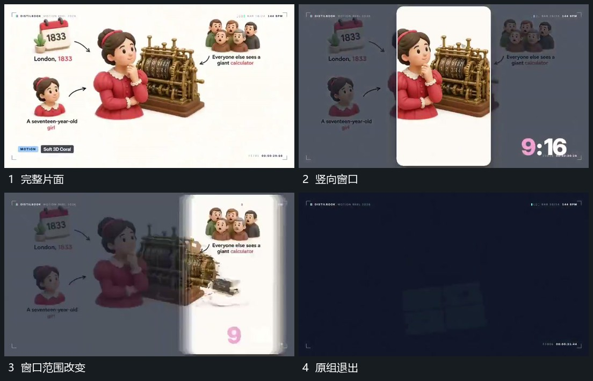

# 完整片面限定竖向可见区，外部退暗后改变窗口形态

## 运动指令

在完整片面前建立竖向可见区，区外内容退暗，内部保持可见。随后改变可见区的宽高关系或用边界覆盖接替范围，底层材料仍来自同一片面，末尾整体退出。

## 视频切片

[播放本机制的原片切片](m07.mp4)

覆盖分镜中“完整片面”至“原组退出”的连续过程，并保留邻近的前后衔接画面；原片中交叠发生的动作一并保留。

## 分镜过程

## 组合与调整

范围变化须保留来源，不把两个无关裁切静图当作连续运镜。
