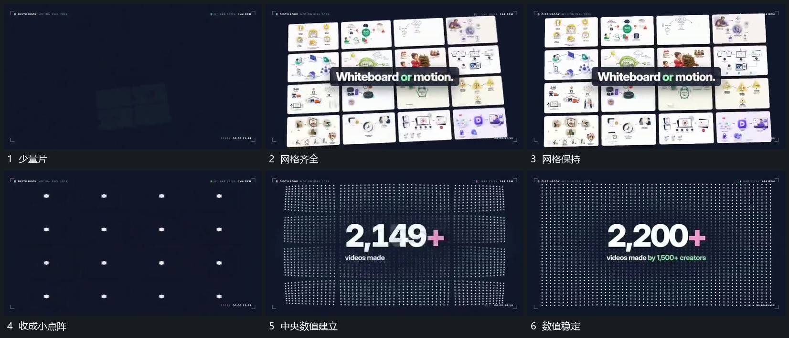

# 多片铺成网格，再收成小点阵，中央数值持续增长

## 运动指令

从少量片开始铺成完整网格，网格保持后缩回并接成小点阵。点阵在后层保留，中央数值建立并持续增长，到结果后补附属短行，整体稳定。

## 视频切片

[播放本机制的原片切片](m08.mp4)

覆盖分镜中“少量片”至“数值稳定”的连续过程，并保留邻近的前后衔接画面；原片中交叠发生的动作一并保留。

## 分镜过程

## 组合与调整

点阵可以是网格的简化继承，不要求各点真实对应一片，但接管过程应可追踪。
