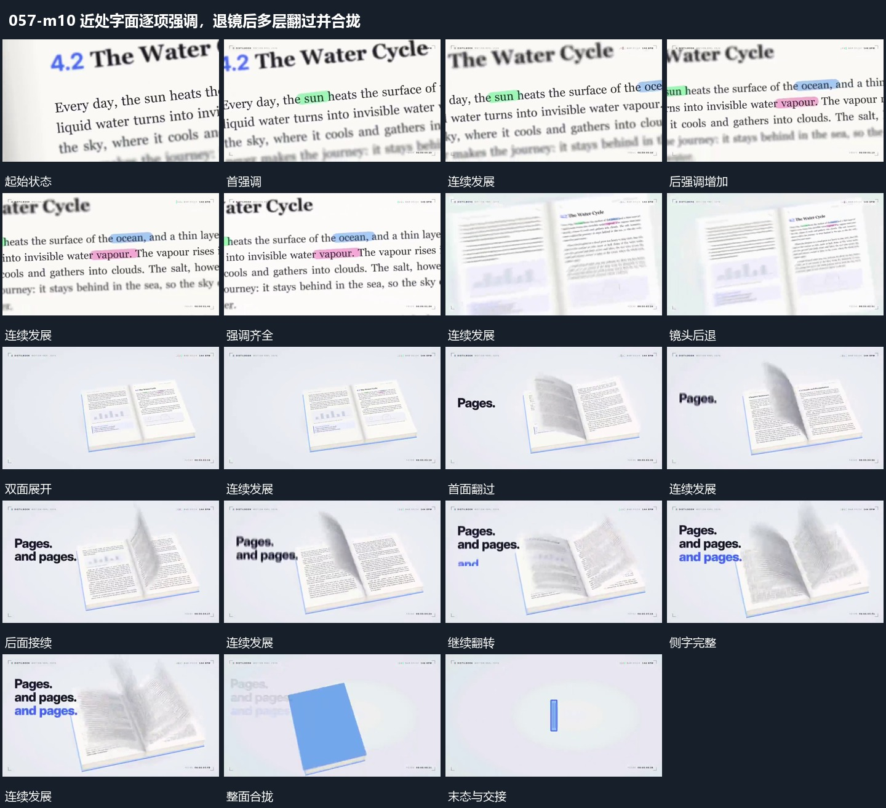

# 近处字面逐项强调，退镜后多层翻过并合拢

## 运动指令

先在近处字面建立强调，退镜显出完整平面；多层绕中轴依次翻过，侧字接力后整体合拢。

1. **近景字面逐项建立强调，退镜后保留字面为整体片**

在字面近景中逐项建立局部强调，已强调部分保持。完成后后退显出完整片面与相邻片，强调仍留在原字面位置，形成局部到整体的连续关系。

2. **多层平面绕中轴依次翻过，侧字分行增加后整面合拢**

保留共同中轴，让多层平面依次翻过，前面接到另一侧后后面继续。侧字分行增加，前行保持；末尾将整组平面合拢成单片，再交给下一标记组。

整段结束：整面合拢为单片 保留必要落稳与交接，中间已建立的参照沿用到下一步骤。

## 视频切片

[播放本机制的原片切片](m10.mp4)

保留起始准备、连续发展和完成或明确交接；首尾按本段运动范围裁切，不拼接、不变速。相连的小动作合为同一完整段落。

## 分镜过程

## 组合与调整

先在近处字面建立强调，退镜显出完整平面；多层绕中轴依次翻过，侧字接力后整体合拢。 复用时可调整元素数量、幅度和相对节奏，保留上述进入、交叠与完成关系；不直接沿用原片题材或时长。

可换任何字面或细节材料，不继承原文字内容。

不要求原片书本结构，用平面堆叠也可实现，重点是同轴连续接力。
