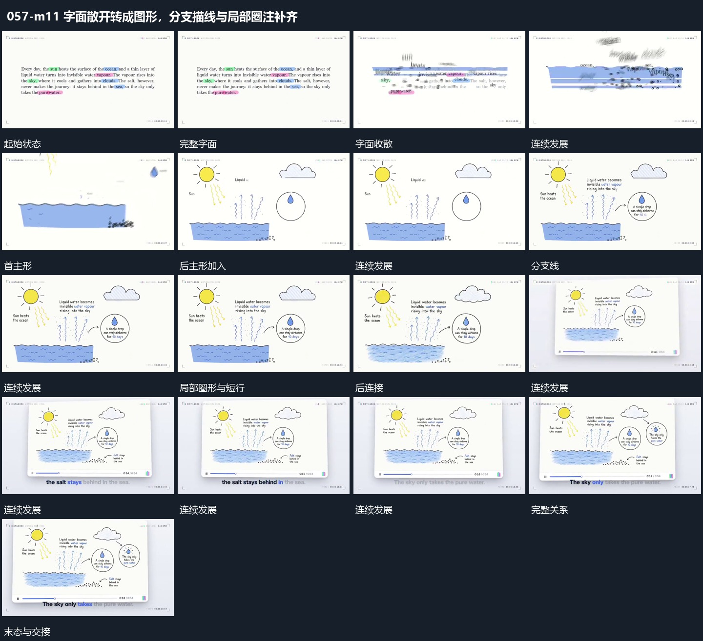

# 字面散开转成图形，分支描线与局部圈注补齐

## 运动指令

原文字从所在区域散开，新图形逐步在原处形成；主形建立后分支线、局部圈注与旁字接力补齐。

1. **字面收散，原区域图形轮廓分批补出**

让完整字面向局部收散，旧字逐步退出主要位置。在原承载区域分批补出图形轮廓，先主要形再次要形，短行与标记随后接入，使两类承载连续交接。

2. **主形先建立，分支线和局部圈依次补齐**

先建立几个主要形，再延伸分支线连接已出现部分。局部圈形接在相应分支旁，内部小形与短行随后补齐；前项保持，最后形成完整关系组。

整段结束：主形、连接和附属说明齐全 保留必要落稳与交接，中间已建立的参照沿用到下一步骤。

## 视频切片

[播放本机制的原片切片](m11.mp4)

保留起始准备、连续发展和完成或明确交接；首尾按本段运动范围裁切，不拼接、不变速。相连的小动作合为同一完整段落。

## 分镜过程

## 组合与调整

原文字从所在区域散开，新图形逐步在原处形成；主形建立后分支线、局部圈注与旁字接力补齐。 复用时可调整元素数量、幅度和相对节奏，保留上述进入、交叠与完成关系；不直接沿用原片题材或时长。

不假定文字真实变成物体，用清楚的位置接续保留同样运动关系。

只有真实相连部分才画线，避免同时描出全部细节而失去推进。
