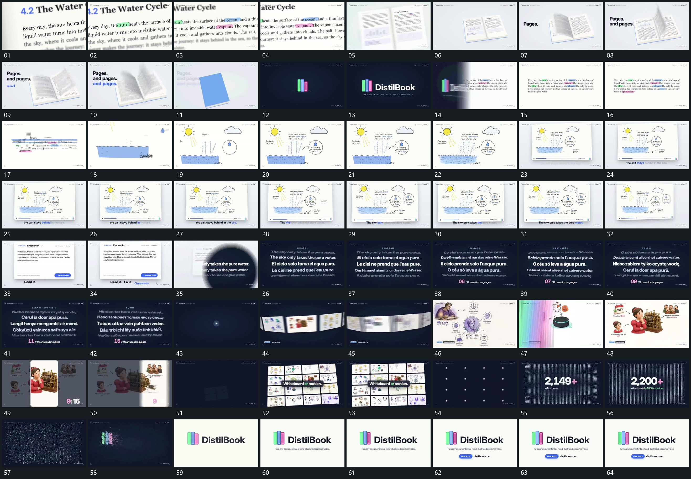

# 057｜原片运动总览

[观看完整原片](video.mp4)

## 运动总览

开场 近景字面逐项建立强调，退镜后保留字面为整体片 在近景字面中逐项建立强调，随后退镜到双片并置。多层平面绕中轴依次翻过，侧字分行增加后整面合拢 让多层平面绕中轴翻过，侧字逐行追加，末尾整面合拢；标记与字组短暂接管。原字面回来，字面收散，原区域图形轮廓分批补出 将字面收散并在原区域补出图形轮廓，主形先建立，分支线和局部圈依次补齐 从先立主形到分支线、局部圈与附属短行逐项建立完整关系图。

图形组缩到新框内，沿用 近景字面逐项建立强调，退镜后保留字面为整体片 推进下方短句的局部强调。下一片接管后 圆形覆盖扩张换底，纵向字行轮换，中央行突出 从局部圆形覆盖扩张换底，字行沿纵向轮换，中央行突出，前后行退弱。图片条带沿弧面侧向经过，选定平面接管满幅 让图片条带沿弧面侧向经过，再进入一张完整片。完整片面限定竖向可见区，外部退暗后改变窗口形态 在全片前限定竖向可见区，外部退暗，随后改变可见区形态。

末段 多片铺成网格，再收成小点阵，中央数值持续增长 多片逐项铺成网格，再收成小点阵，数值建立并增加。点阵打散再汇成中央短形，短字和附属条接续 将点阵打散，再收成中央短形，主字和附属条接上，结束保持。

## 完整运动段落

以下按原片中的出现顺序引用。建立、内部发展及完成反馈放在同一段中；同时发生的局部动作与运镜写在同一份指令里。不同段之间可以是连续接管，也可以是直接切换，不能仅凭条目相邻认定可直接拼接。重复出现的同类运动采用一次连续代表范围，切片不以逐段无缝覆盖整片为目标。

1. [近处字面逐项强调，退镜后多层翻过并合拢](mechanisms/m10.md)：先在近处字面建立强调，退镜显出完整平面；多层绕中轴依次翻过，侧字接力后整体合拢。

2. [字面散开转成图形，分支描线与局部圈注补齐](mechanisms/m11.md)：原文字从所在区域散开，新图形逐步在原处形成；主形建立后分支线、局部圈注与旁字接力补齐。

3. [圆形覆盖扩张换底，纵向字行轮换，中央行突出](mechanisms/m05.md)：圆覆盖先接管，文字随后轮换

4. [图片条带沿弧面侧向经过，选定平面接管满幅](mechanisms/m06.md)：侧向流动，选片逐渐转正

5. [全幅收成竖向窗口，铺成网格再化点阵聚成结尾](mechanisms/m12.md)：先限制竖向可见区，再改变窗口形态并铺成网格；多片收成点阵、数值增长，点阵散开后重新聚成中央短形并补齐结尾。

切片保留起始准备、必要内部停顿和完成或明确交接；首尾省略无新发展的等待，持续运动不要求人为停住。以上基于真实源帧序列和重点边界核对，不等同于全片连续声画审片。

## 完整64宫格

