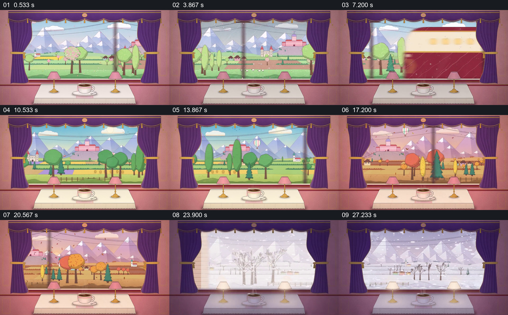

# 固定车厢和茶杯，让窗外景色经历季节变化

- 作品：案例 062《列车窗外的季节变化》（索引名称）。
- 原片范围：00:00.000–00:30.058，含起点、不含终点；[完整原片](../video.mp4)｜[本卡片段](../video.mp4)。
- 观察方式：依据整片 64 宫格和约每秒一次的真实源帧观察，未连续原速观看或听审；声音、语气与完整播放节奏未确认。

## 原画面具体怎样设计

紫色窗帘、桌面、灯和茶杯始终位于前景，窗外是山、树和村庄；一列车从窗前经过后景色变为更浓的绿色，随后转为橙黄色，经过暗场后出现积雪和光亮。末尾雪景边缘露出绿色。

## 为什么这样设计，好在哪里

车厢与茶杯不变，窗外的色彩和植被变化因此可直接比较；列车与暗场为变化提供视觉交接。逐秒抽样不能确认真实循环或每个转场的连续性。

以上为依据画面的分析，非作者自述；预期观看效果未经观众测试。

## 可直接使用的创意指令

当要以同一观察位置表现环境变化时，先固定有辨识度的室内前景，再围绕相同空间位置准备各阶段的真实或设计画面；选择有内容理由的遮挡或光线变化交接，并连续观看检查时间与空间关系。
