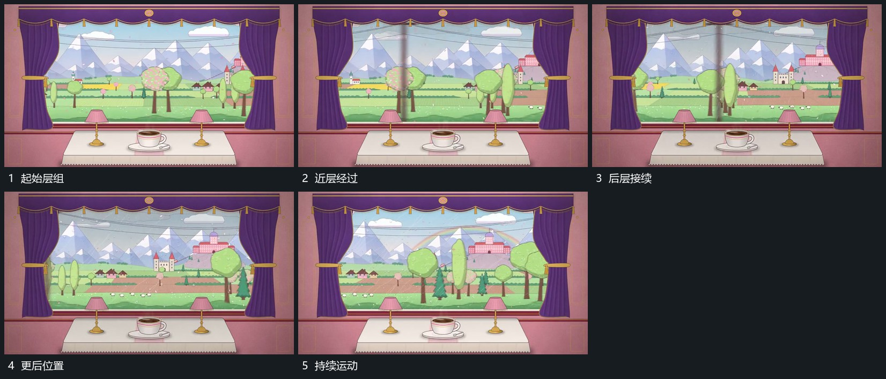

# 固定窗口内远近层同向经过，近层较快，前层保持

## 运动指令

保留固定前层窗口，让内部多层沿同一侧向经过。近层移动较快，远层较慢，形成相对位移；窗口外前景与边界保持，内部内容从边缘进出。

## 视频切片

[播放本机制的原片切片](m01.mp4)

覆盖分镜中“起始层组”至“持续运动”的连续过程，并保留邻近的前后衔接画面；原片中交叠发生的动作一并保留。

## 分镜过程

## 组合与调整

可换任意远近素材，不要求原场景。不要把外部前层一起平移。
