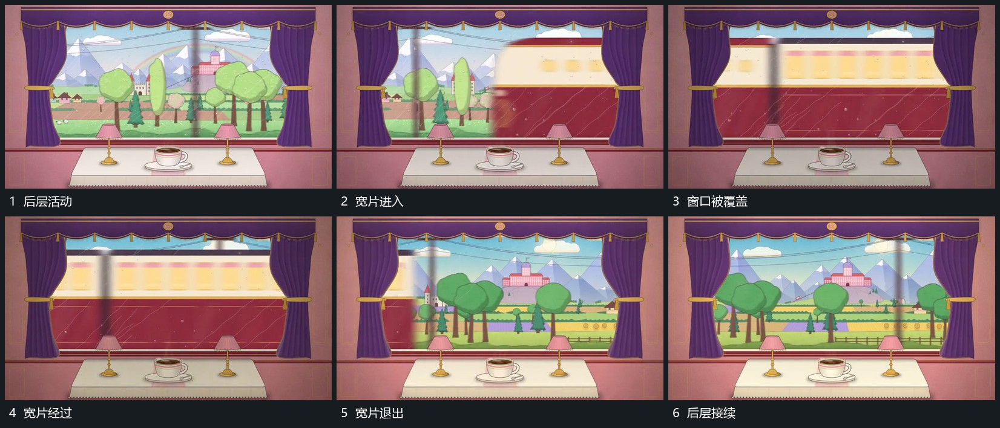

# 宽长片侧向横穿窗口，遮住后层后退出

## 运动指令

让宽长片从侧方接入，横向穿过窗口，在窗口内遮住后层。宽片继续沿同方向退出，后层在遮挡期间维持自身运动，退出后接回原空间。

## 视频切片

[播放本机制的原片切片](m02.mp4)

覆盖分镜中“后层活动”至“后层接续”的连续过程，并保留邻近的前后衔接画面；原片中交叠发生的动作一并保留。

## 分镜过程

## 组合与调整

宽片可换为任意遮挡层，关键是遮挡前后后层连续。
