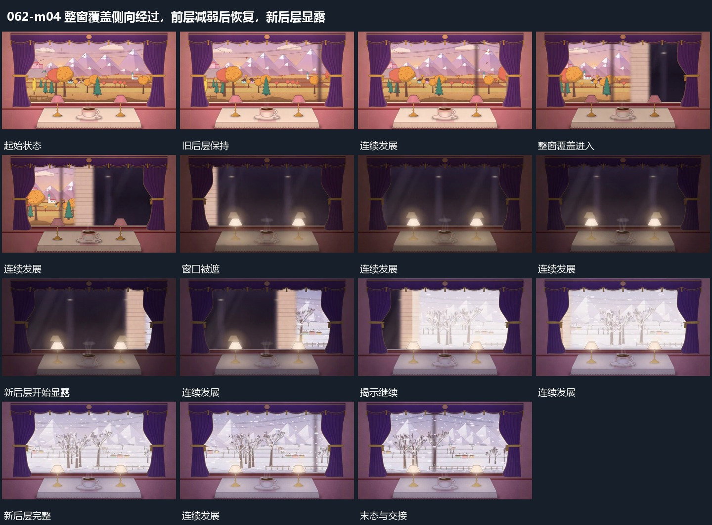

# 整窗覆盖侧向经过，前层减弱后恢复，新后层显露

## 运动指令

让整窗覆盖从一侧经过，逐步遮住全部后层，外部前层在位置保持时整体减弱。覆盖继续经过后显露新后层，前层恢复，窗口内局部小点持续下落，侧向视差继续。

## 视频切片

[播放本机制的原片切片](m04.mp4)

保留起始准备、连续发展和完成或明确交接；首尾按本段运动范围裁切，不拼接、不变速。尾部只保留理解结果所需的展示。

## 分镜过程

## 组合与调整

只描述可见强弱接续，不分析灯光美术。覆盖进入和揭示应沿同一空间边界完成。
