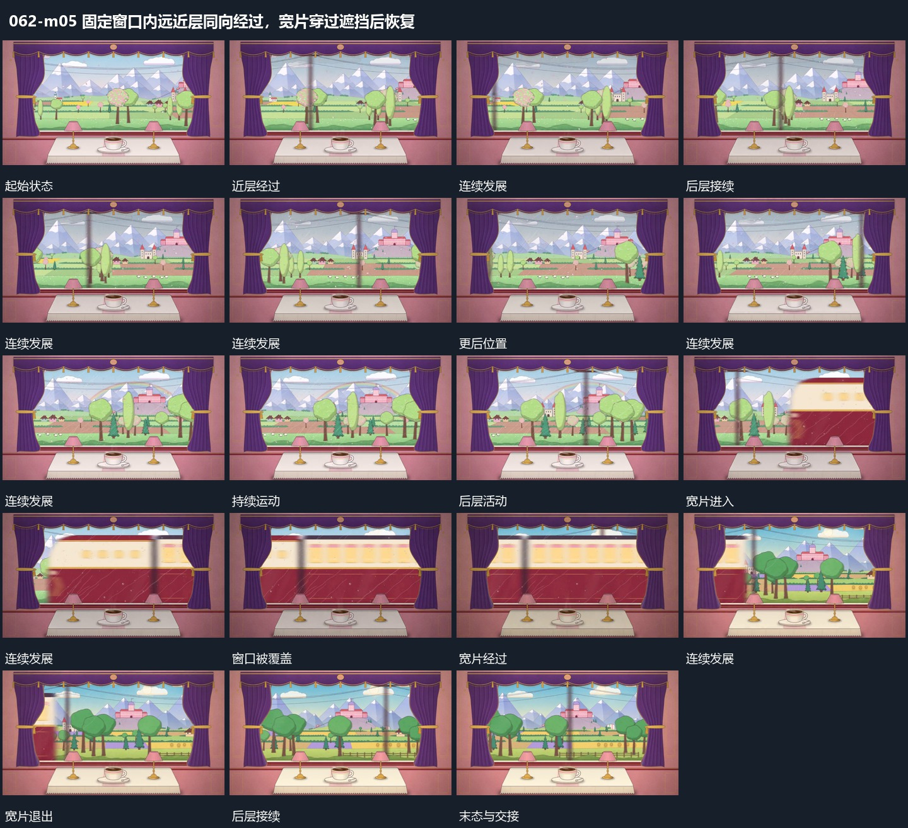

# 固定窗口内远近层同向经过，宽片穿过遮挡后恢复

## 运动指令

起始：窗口与多层内容完整。

1. 窗口与前层保持，远近景以不同速度同向经过。

2. 宽片从侧边进入遮住后景，通过后再次露出持续移动的层次。

上述镜头变化与局部动作按同一条连续过程推进；写明同时发生的步骤在原场面中交叠，不先完成整段运镜再重演局部。

## 视频切片

[播放本机制的原片切片](m05.mp4)

保留起始准备、连续发展和完成或明确交接；首尾按本段运动范围裁切，不拼接、不变速。相连的小动作合为同一完整段落。

## 分镜过程

## 组合与调整

保留以下动作关系：窗口与前层保持，远近景以不同速度同向经过；宽片从侧边进入遮住后景，通过后再次露出持续移动的层次。

可调整位移距离、层级间距、重复数量与相对快慢；已有锚点和未退出的层继续承接。连接下一段时以切片末态为起点，另行设计不连续的状态转换。
