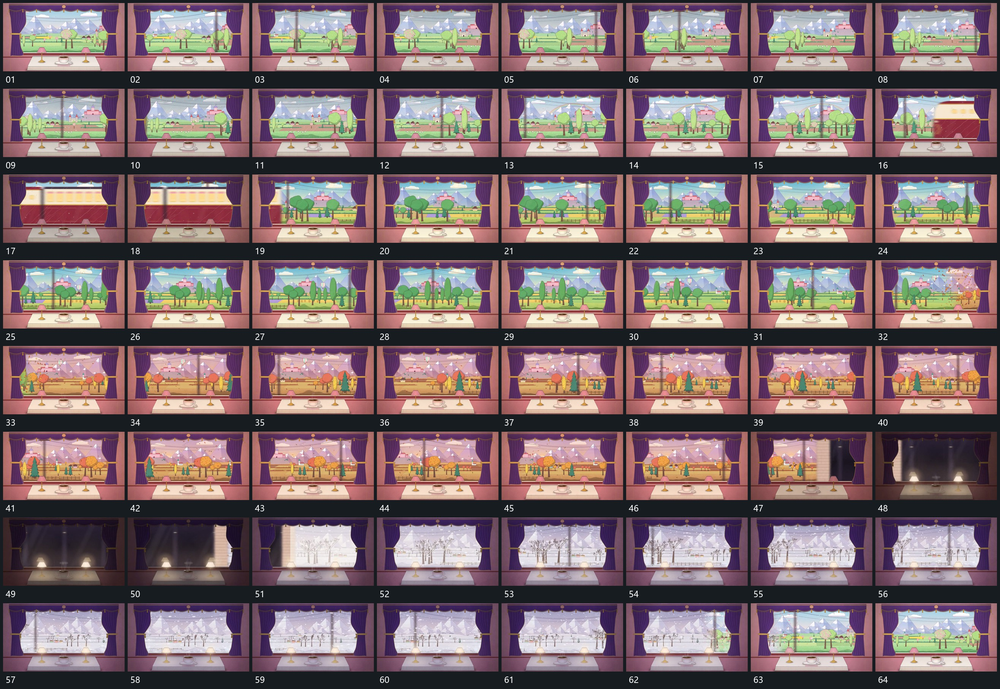

# 062｜原片运动总览

[观看完整原片](video.mp4)

## 运动总览

全片以固定前层窗口为持续边界。固定窗口内远近层同向经过，近层较快，前层保持 在窗口内让远近层同向经过，近层移动较快，前层位置保持。宽长片侧向横穿窗口，遮住后层后退出 宽长片从侧边进入，横穿窗口遮住后层后退出，原空间继续活动。

中段 散小片从侧方进入，新后层逐步接管固定窗口 从侧方接入散小片和替代状态，让新后层逐步接管窗口，前层边界不动。整窗覆盖侧向经过，前层减弱后恢复，新后层显露 用整窗覆盖从一侧经过，前层局部整体减弱，覆盖退出后新后层显露，前层恢复；新后层中的小点持续下落。末段再次使用 散小片从侧方进入，新后层逐步接管固定窗口 从侧方替换后层，回到起始状态形成循环。

## 完整运动段落

以下按原片中的出现顺序引用。建立、内部发展及完成反馈放在同一段中；同时发生的局部动作与运镜写在同一份指令里。不同段之间可以是连续接管，也可以是直接切换，不能仅凭条目相邻认定可直接拼接。重复出现的同类运动采用一次连续代表范围，切片不以逐段无缝覆盖整片为目标。

1. [固定窗口内远近层同向经过，宽片穿过遮挡后恢复](mechanisms/m05.md)：窗口与前层保持，远近景以不同速度同向经过；宽片从侧边进入遮住后景，通过后再次露出持续移动的层次。

2. [散小片从侧方进入，新后层逐步接管固定窗口](mechanisms/m03.md)：侧边先变化，再接管整体

3. [整窗覆盖侧向经过，前层减弱后恢复，新后层显露](mechanisms/m04.md)：覆盖先到，前层减弱，揭示后恢复

切片保留起始准备、必要内部停顿和完成或明确交接；首尾省略无新发展的等待，持续运动不要求人为停住。以上基于真实源帧序列和重点边界核对，不等同于全片连续声画审片。

## 完整64宫格

