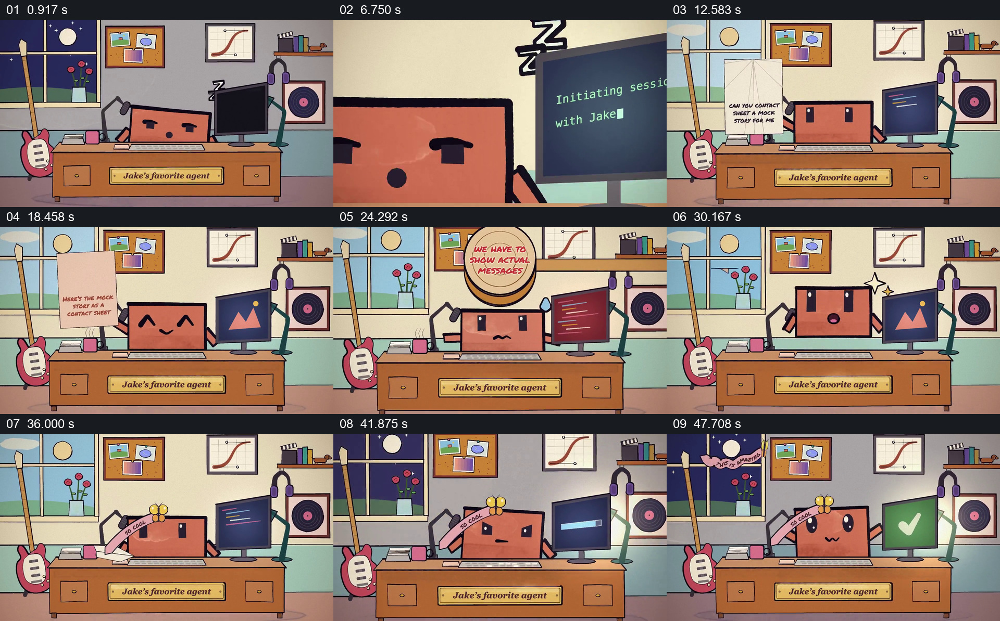

# 把任务、纠正和反馈交给固定桌面的拟人助手

- 作品：案例 082《拟人助手的任务与反馈》（本次概括）。
- 原片范围：00:00.000–00:52.672，含起点、不含终点；[完整原片](../video.mp4)｜[本卡片段](../video.mp4)。
- 观察方式：依据约每秒一次的真实源帧观察，未连续原速观看或听审；声音、语气与完整播放节奏未确认。

## 原画面具体怎样设计

夜晚桌面上的屏幕角色和旁边显示器先处于休息状态，显示器出现启动会话文字后窗外变亮。角色拿起写有请求的纸，屏幕显示图像；随后大印章落下，出现要求呈现真实消息的提示，屏幕变红，角色显出紧张。新的纸条与屏幕内容接续，画面出现绿色勾、爱心和奖励标识；后面又有纸条进入，角色继续处理，窗外再次变暗，结尾聚焦角色。

## 为什么这样设计，好在哪里

固定房间、桌面和角色让观众持续追踪同一助手，纸条、屏幕颜色及表情把任务与反馈变成可辨的角色互动。画面中的结果是拟人化示意，具体任务内容未完整核读。

以上为依据画面的分析，非作者自述；预期观看效果未经观众测试。

## 可直接使用的创意指令

表现助手处理任务并接受反馈时，先固定能容纳输入和结果的工作空间，用可读请求建立任务；让纠正直接作用于已有结果，并展示角色或界面的变化，再以新的输出和反馈收束。用真实请求与结果对应具体修改，拟人表情仅承担情绪表达。
