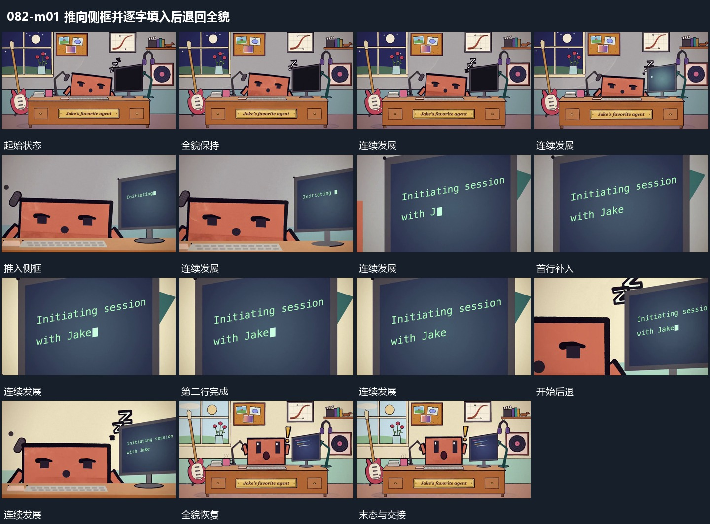

# 推向侧框并逐字填入后退回全貌

## 运动指令

沿侧框位置推近，让其逐步占据主要范围，邻框只留下部分边缘作为参照。框内短行从前到后补齐，第二行随后加入。字行完成后镜头退回，露出原完整空间，框内结果保留。

## 视频切片

[播放本机制的原片切片](m01.mp4)

保留起始准备、连续发展和完成或明确交接；首尾按本段运动范围裁切，不拼接、不变速。尾部只保留理解结果所需的展示。

## 分镜过程

## 组合与调整

可用图块替代字行；推近与退回作用于共同空间，不能只缩放字行。
